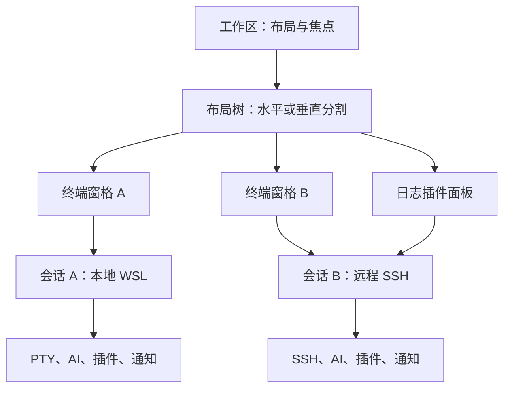

# HexHub 对比与多会话工作区评估

日期：2026-11-09。AITerminal 基线为 1.6.1、源码 `eeda5d488f607572323bc1d6870da441e1ef3019`。本文保留当时的评估与设计建议，以下“当前”均指这一基线。

后续状态：1.7.0 已实现原生分屏、会话搜索、工作区布局保存/恢复、SFTP 文件面板与固定插件面板。当前操作和验证见 [使用手册](USER_GUIDE.md#多会话工作区)与[工作区验证](WORKSPACE_VERIFICATION.md)。主机分组、批量执行、跨会话编排及对外 MCP 服务端仍待实现。

目标是判断社区提出的“借鉴 HexHub，放开会话数量和分屏限制”能否成为有价值的改进。评估依据包括 HexHub 官网、定价、官方帮助文档及产品截图，当前项目源码，以及隔离配置下的真实 Electron/PTY 检查。没有安装或跑分 HexHub 当前客户端，因此不比较两者实际性能，也不推断未公开的客户端配额。

## 结论

建议优先建设**不设商业数量配额的多会话工作区**：独立终端分屏、资产组织、布局恢复，再将插件面板和 AI 任务放进同一工作区。现有本地 PTY、SSH、会话隔离和插件宿主可以复用；布局、焦点和会话生命周期需要分开建模。

HexHub 的优势是成熟的资产、终端、文件、数据库和容器工作流。它已经有 BYOK AI Agent 和 MCP，也采用插件进程，所以不能把“有 AI”“有插件”说成独有优势。AITerminal 更值得验证的方向是 Apache-2.0 开放的插件 SDK、可离线使用的基础能力、免费分屏，以及绑定明确会话的插件与 AI 协作。数据库全家桶和移动端应单独评估，首轮不承诺对齐全部功能。

## 已确认的 HexHub 信息

| 来源 | 可以得出的结论 | 不能据此推断的内容 |
| --- | --- | --- |
| [官网](https://www.hexhub.cn/) | SSH/SFTP、Docker、数据库、多个终端视图；BYOK 通用/终端/SQL Agent；通过 MCP 对外提供能力 | 具体操作可靠性、并发上限和运行性能 |
| [定价页](https://www.hexhub.cn/pricing) | 多窗口、SSH 命令广播、SFTP 服务器互传、同步等列为专业版权益 | 免费版最多允许几个 SSH 会话或几个分屏；页面未列明确数字 |
| [如何使用分屏＋广播输入](https://www.yuque.com/u12317921/kb/fbssy6hbf270b6se) | 公开文档摘要写明“此功能专业版可用”；支持拖拽资产/标签组成分屏、批量选择 SSH 资产后同屏打开、手动开启广播 | 精确分屏数量上限；没有从摘要得到该数字 |
| [专业版和增强版区别](https://www.yuque.com/u12317921/kb/en2h64i8ks6x7948) | 文档明确专业版 3 台、增强版 6 台**同时登录设备**，超出时踢出最早的登录会话 | 不能把设备登录会话等同于 SSH 终端连接数 |
| [MCP 帮助](https://www.yuque.com/u12317921/kb/hogp1ez3vmvhn2ni) | 提到 Codex、Claude Code 等 Agent 调用 HexHub MCP，以及启动时发现服务的要求 | 不能将“终端供外部 Agent 调用”当作 AITerminal 已独占的方向 |
| [离线环境](https://www.yuque.com/u12317921/kb/uts37yct825eyzms) / [插件更新](https://www.yuque.com/u12317921/kb/day1gtaywfs5s76c) | 帮助摘要说明首次使用需联网初始化插件；架构分离 UI 与 Agent 插件进程 | 不能据此断言它没有插件机制，也不能判断社区第三方 SDK 的完整开放程度 |

公开页面与文档存在更新时差，权益最终以对应客户端版本为准。未核实的“最多 N 个终端”不应写进宣传材料。帮助页的部分正文采用动态加载，本次采用页面公开的 `doc.description` 摘要与官网信息，没有将未读取的正文当作证据。

## 能力差距与投入顺序

| 能力 | AITerminal 1.6.1 的实际状态 | 建议与优先级 |
| --- | --- | --- |
| 多终端分屏 | 每个标签独立 xterm/PTY/SSH，但每次只显示一个标签；AI 面板占右侧 40%，属于终端与 AI 并排；tmux 是单个终端内部的分屏 | **P0**：水平/垂直递归分屏、拖动分隔线、合并/移动窗格、当前窗格放大、键盘切换；本地与不同 SSH 主机可同屏 |
| 会话数量 | 创建标签与后端注册表未发现商业数量配额；真实本地 32 PTY 检查通过 | **P0**：保持无商业配额；补充连接列表、搜索、状态与资源预算。32 是本次检查规模，不是产品上限或无限性能承诺 |
| 资产管理 | 有连接配置方案和导入导出；尚无持久的主机树、标签分组及工作区布局 | **P1**：主机分组、收藏、最近连接、名称/颜色、批量打开与搜索；导入 OpenSSH 配置时声明支持的字段和不支持的语义 |
| 工作区恢复 | “保存会话”导出一份去除凭据的连接配置，不保存全部标签、布局或运行进程 | **P1**：恢复连接引用、布局、目录和已固定的插件面板；区分重建连接与恢复原进程 |
| 广播与批量操作 | 没有面向多个选定会话的广播/批量执行入口 | **P1**：先做完整命令批量提交、逐目标结果和单独取消，再评估原始按键广播；复用命令审计与服务器信任 |
| 文件工作流 | 有 `rfe`、`myls`、上传、下载和外部打开能力 | **P1**：将文件浏览固定到会话旁，增加传输队列、进度、取消和远程编辑后的差异确认；后续再做跨服务器传输 |
| Docker / 服务器监控 | 已有 Docker 工作台插件，含列表、操作、日志和巡检；尚无完整的常驻服务器仪表板 | **P2**：把现有面板固定到工作区；增加按需采样的资源、进程、服务和日志插件，复用连接，不向交互终端偷偷输入采样命令 |
| AI 与 Codex | 有三种 API 协议、同环境接管、交互式 PTY、通知；任务主要属于单个标签 | **P2**：显式选择会话组成任务，分目标执行并汇总证据；保留每个任务的取消、目标身份和通知归属 |
| MCP | `lib/pluginMcpHost.js` 是连接外部 MCP 服务的客户端桥接 | **P2**：另行设计供 Codex 等调用的 AITerminal MCP 服务端；“接入 MCP”与“对外提供 MCP”分别说明 |
| SSH 网络能力 | 当前主要是直接连接；未发现跳板链、隧道管理或完整断线恢复入口 | **P1/P2**：先保活、明确断线状态与手动/可配置重连，再做 ProxyJump、隧道；重连不自动重放任务命令 |
| 数据库 GUI / 移动端 | 未实现 HexHub 那样的多数据库管理和移动客户端 | **后续独立方向**：先尝试只读 SQL/Redis 诊断插件，完整编辑器另立项目范围 |

## 当前实现的关键瓶颈

1. **一个标签同时承担连接、视图和焦点。** `renderer.js` 的 `switchToTab()` 撤销其他所有标签的 `.active`；`isTabVisible()` 依赖这个标记；输入、剪贴板和部分渲染依赖 `activeTabId`。`index.html` 将标签内容绝对定位为占满整个区域。直接让几个标签同时加 `.active` 会叠屏，也不会自动得到正确的输入和 resize 路由。
2. **AI 面板改变所有终端容器的宽度。** `.main-content.ai-active .terminal-container` 将宽度改为 60%。未来多窗格应给整个工作区分配剩余空间，不能让每个叶子终端再各缩一次。
3. **持续输出缺少明确的端到端背压。** 本地/SSH 数据通过 IPC 到达 renderer 后直接 `terminal.write()`；现有日志片段上限不等于传输队列有界。`scrollback` 默认 1,000 行、加载配置时最多 100,000 行，也不能替代多会话总内存预算。此项是源码风险识别，本次没有制造日志洪水或证明它已发生内存故障。
4. **持久化仍以单份连接配置为中心。** `saveCurrentSession()` 导出 `sshConfig`；切换标签的 `syncTabAiConfig()` 又读取同一份保存配置。工作区设计需要区分用户默认、连接方案、会话快照与临时覆盖，明确切换视图时哪些值应保持。
5. **插件面板还集中在插件中心。** 当前表格/文本面板可复用，但“固定到工作区后切换焦点仍保持原服务器归属”需要独立视图订阅，不能简单复用活动标签的 DOM。

证据入口：[会话注册表](lib/tabRegistry.js)、[事件路由](lib/tabEventRouter.js)、[终端 renderer](renderer.js)、[布局](index.html)、[PTY/SSH 与 IPC](main.js)、[插件 UI](pluginCenter.js)、[MCP 客户端](lib/pluginMcpHost.js)。现有会话所有权和后端代次校验应成为迁移基础。

## 推荐结构与迁移方式

用三个概念拆开责任：

| 对象 | 管理什么 | 何时失效 |
| --- | --- | --- |
| Session（会话） | PTY/SSH、AI 历史、执行目标、任务、通知和插件作用域 | 显式关闭会话；重连更新后端代次 |
| Pane（窗格） | 一个终端或绑定会话的 AI/插件视图、焦点、可见性与尺寸 | 关闭或移动视图；不应因为重新排版而重建连接 |
| Workspace（工作区） | 递归布局树、活动窗格、资产引用与布局保存 | 关闭工作区时按会话是否仍被使用决定处置 |

- 第一阶段每个终端窗格拥有独立会话；同一会话只对应一个终端视图，避免两个视图争抢 PTY 尺寸。插件面板可以绑定该会话，不拥有终端尺寸。旧标签迁移为只有一个叶子窗格的工作区。
- 保留已有 `windowId + tabId` 路由作为初期会话身份，增加布局层；所有异步动作在发起时捕获会话与后端代次，焦点变化不能改变已发出的命令目标。逐步消除活动终端全局别名，不一次性重写执行系统。
- 分开“可见窗格集合”与“当前输入焦点”。所有可见终端按各自容器 fit；隐藏终端不 fit 为零尺寸，但继续处理终端状态与任务。尺寸更新合并到帧，忽略未变化尺寸，并保证拖拽结束后提交最终值。
- 窗格重排保留同一个 xterm 与 PTY。跨窗口拖拽需要所有权转移协议，先处理同窗口分屏；不能修改一个 `windowId` 后让两个窗口同时发送输入。
- 工作区文件使用带版本号的布局 Schema，引用连接与系统凭据，保存非敏感偏好；密钥仍留在安全存储。恢复布局不代表恢复 Shell 进程，不自动重放上次命令。跨应用重启保活需要 tmux/独立后台服务，另作设计。
- AI 侧栏可收起、调宽、固定到某会话或跟随焦点；多会话任务显式选择目标集合。插件仅获得任务授权范围中的服务，不因可见窗格变多而自动获得其他会话权限。

## 两个能体现插件价值的场景

**排查发布故障**：工作区左侧是部署主机终端，右侧上方固定该主机 Docker 插件，右侧下方固定日志面板；AI 根据用户选中的这些来源定位异常，提出修改，执行后以健康检查验证，并通过现有 Webhook 报告结果。终端、日志和容器工具可分别替换为社区插件。

**并行运行 Codex**：为两个独立项目目录/工作副本建立两个本地窗格，分别运行交互式 Codex；同屏查看进度、等待输入状态和任务通知。后续协调插件只汇总所选任务，保留各自上下文；并发修改同一工作副本需要另行处理冲突，分屏本身不能解决。

这两项应作为发布演示和用户试用任务。观察任务能否完成、切换窗口次数、完成时间和误投目标次数，再判断是否比单标签版本更好。尚没有用户迁移或受欢迎程度的数据，不能把社区的一条评论当成市场验证。

## 分阶段交付与验收

| 阶段 | 首要交付 | 验收 |
| --- | --- | --- |
| A：原生分屏 | 布局树、水平/垂直拆分、调宽、移动、放大、快捷键；可调 AI 侧栏 | 本地与不同 SSH 会话同时展示；关闭/拖动/切换焦点不串输入、输出、剪贴板、AI、通知；tmux/Unicode/鼠标和 resize 回归 |
| B：工作区与资产 | 主机树、连接搜索、布局保存、重开、完整命令批量执行、常驻文件面板 | 恢复连接引用和布局，不泄漏凭据、不重放旧命令；批量结果逐目标标记，取消一项不误停其他任务；断线状态明确 |
| C：插件与 AI 协作 | 面板固定、Docker/日志/监控插件、选定会话编排、外部 MCP 服务端 | 插件面板不随焦点串服务器；模型和外部 Agent 都用同一目标校验与执行审计；任务结束/失败通知可追溯 |

阶段 A 同时建立负载验证：以 **32 个存活会话、其中 8 个可见窗格**作为首轮目标规模，并保持用户可继续创建会话；这是验证目标，不是硬性产品数量限制。按已记录的参考机器、输出速率和屏幕尺寸运行至少 30 分钟，测量应用及子进程总 RSS、CPU、输出队列、输入到回显的 p95 延迟。先获得基线，再给出有依据的性能承诺。

持续输出应采用逐会话有界队列、xterm 写入完成确认和 PTY/SSH 背压，保持不同会话的处理公平性；不能任意丢弃控制序列或停止隐藏终端的程序。可见窗口优先渲染，后台仍保留正确终端状态。WebGL 可作为可选优化，需评估多上下文成本和上下文丢失回退，不能只换渲染器就宣称解决吞吐问题。

原生分屏验收覆盖 DPI 100%/125%/150%/200%、字号变化、窗口缩放、中文/emoji、tmux/vim/交互式 CLI；Windows 实际初始化 Ubuntu 后检查 WSL，不能用未安装 WSL 的 runner 跳过来替代。Linux/macOS 各自执行本地 PTY 与打包启动检查。SSH 需要真实服务端，不能由本地 PTY 结果代替。

## 本次实际验证

运行环境：WSL2 Linux x64，Electron 使用独立临时配置、headless、禁用 GPU，视口 1099×824；不读取用户已有连接配置，也不调用模型或远端服务器。

| 检查规模 | 真实本地 PTY | 同时可见终端 | 每轮独立输出标记 |
| --- | --- | --- | --- |
| 1 标签 | 1 | 1 | 通过 |
| 8 标签 | 8 | 1 | 通过 |
| 16 标签 | 16 | 1 | 通过 |
| 32 标签 | 32 | 1 | 通过 |

每轮向所有 PTY 写入包含本轮编号与会话 ID 的命令，等待真实输出，并检查其他会话的标记没有进入本终端；随后关闭额外标签，确认回到仍活动的单标签。测试程序退出时清理临时 Electron 进程与配置。

复现：在已可运行本地终端的开发环境执行 `node scripts/sessionBaseline.js`，输出 JSON 记录。脚本见 [sessionBaseline.js](scripts/sessionBaseline.js)。本次结果**不代表 32 路 SSH、8 窗格渲染、持续高吞吐、无内存泄漏或跨平台性能已经验证**；这是对“是否已有多会话基础”的功能检查。

上述为实施前评估阶段的验证，没有涵盖后续产品改动。1.6.1 的完整测试与三平台发布记录见 [文档恢复验证](DOCUMENTATION_RESTORATION.md)，新工作区验收另见 [1.7.0 验证](WORKSPACE_VERIFICATION.md)。

## 复刻的实现边界

可以独立实现这些通用终端交互与工作流。HexHub 的 [旧公开仓库](https://github.com/EdikKing/hexhub) 最后推送时间为 2023 年，不能代表 2026 年官网产品；README 写 LGPL-3，但实际 [LICENSE](https://github.com/EdikKing/hexhub/blob/master/LICENSE) 是 GNU GPL v3，GitHub 也识别为 GPL-3.0。不要将旧源码直接复制到本项目并继续仅按 Apache-2.0 分发；本方案基于公开产品行为与 AITerminal 自有实现。

完整数据库编辑器、所有网络协议、移动客户端和云端账号同步均有独立的实现与维护成本。优先把原生分屏和工作区做到可长期使用，再用开放插件扩展业务能力。
