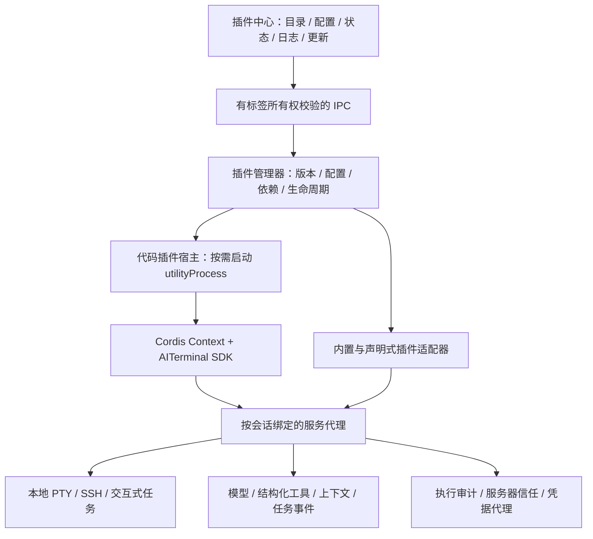

# AITerminal 插件框架与插件中心演进方案

状态：1.5.0 已按本方案实现运行时、SDK、插件管理和 AI/MCP 扩展；2026-11-07。验收记录见 [PLUGIN_VALIDATION.md](PLUGIN_VALIDATION.md)。下文保留架构决策及阶段验收标准。

目标是让 AITerminal 拥有自己的插件框架、开发 SDK 和管理中心，借鉴 DSH/Cordis 的服务组合、生命周期和配置驱动能力。插件作者面向 AITerminal 开发，用户在 AITerminal 内完成发现、配置、运行和维护。

当前可用功能见 [PLUGINS.md](PLUGINS.md)，开发接口见 [PLUGIN_SDK.md](PLUGIN_SDK.md)。实现采用 Cordis 4.0.0-rc.12、Electron utilityProcess 和 AITerminal Plugin API 1.1.0（兼容 1.0）。1.1 在主进程保留按插件与标签隔离的有界会话状态，避免空闲进程回收导致小游戏进度丢失；状态更新使用 revision 防止并发覆盖，停用/更新/关闭时清理。包格式使用有大小限制的 JSON 文件集，避免运行端包管理器及安装脚本；通用 Cordis/DSH 插件仍须适配服务契约。

## 1. 架构选择

建议采用 **Cordis 作为内部生命周期与服务注册底座，AITerminal SDK 作为稳定的插件接口**。锁定并验证 Cordis 版本后引入；插件包遵循 AITerminal 自己的清单规范。Cordis 的上下文与服务注入在进程内工作，跨进程能力由 AITerminal 的 RPC 代理提供。

保留一个小型宿主核心，负责窗口与标签所有权、PTY/SSH 连接、凭据、执行审计、插件进程管理和持久化。逐步把模型适配器、工具、上下文来源、工作流和通知接入扩展接口。主进程中的现有能力先通过服务适配器暴露，再按实际需要拆分，避免一次性重写终端与 AI 主流程。

Electron 的 `utilityProcess` 是首选代码宿主，需要首先在三平台安装产物中验证。入口由应用自身提供，插件代码从用户数据目录加载。现有 `runAsNode: false` 等打包约束继续生效，不依赖用户安装 Node.js 或设置 `ELECTRON_RUN_AS_NODE`。

## 2. 插件能够扩展什么

| 扩展接口 | 插件能力 | 宿主负责的约束 |
| --- | --- | --- |
| `tools` | 注册带参数/结果 Schema 的工具，例如容器列表、重启服务、查日志 | 参数校验、调用归属、超时取消、真实执行内容审计、结果大小限制 |
| `prompts` / `context` | 按当前任务提供指引、项目资料和检索结果 | 标签隔离、上下文预算、来源标记、按需注入 |
| `models` | 模型提供商、流式响应与工具调用协议适配 | 请求归属、取消、凭据代理、统一错误和用量记录 |
| `tasks` / `events` | 巡检流程、任务开始/完成/失败订阅、后台进度 | 事件作用域、任务所有者、并发与取消、事件订阅回收 |
| `terminal` / `files` | 调用本地或 SSH 执行能力、管理插件拥有的交互式进程、读写文件 | 绑定执行目标，沿用执行策略，隔离任务输出；插件不能自行批准命令 |
| `notifications` | Webhook、任务结束提醒、通知模板 | 凭据存储、任务事件关联、限量重试与投递状态 |
| `ui` | 配置表单、菜单、工具结果、状态面板 | 由宿主渲染声明式组件，面板订阅与原始标签绑定 |
| `mcp` | 接入标准 Model Context Protocol 的工具和资源 | 连接生命周期、工具命名空间、会话归属与调用策略 |

第一版 UI 扩展采用宿主提供的表单、表格、日志与按钮组件。任意前端代码与自定义 Web 面板留作独立扩展，届时使用无 Node 权限的隔离页面及专用通信协议。

每个工具采用 `pluginId.toolId` 命名，输入验证通过后才调用实现。支持原生工具调用的模型直接使用工具协议；其他模型经统一解析器转换成同一种工具调用对象。现有 `plugin_run` 保留为旧版动作适配入口，避免形成两条不同的执行审计通路。

交互式工具需要带所有权的会话 API：创建、读取、写入、等待输出、调整尺寸、发送信号和关闭，输出支持流式消费与背压。取消插件任务只操作其拥有的任务进程，用户手工打开的终端仍由终端会话管理。

项目现有名为 MCP 的历史压缩索引，属于上下文管理功能。它应接入 `context` 服务；外部 Model Context Protocol 是新增能力，需要独立实现协议客户端。

## 3. 标签隔离、生命周期与依赖

宿主管理 `app → window → tab → task` 的作用域树；代码插件进程只接收被授予的作用域代理。业务状态默认属于标签或任务。应用级服务必须显式声明，仅共享目录、无会话状态的服务等数据。

- **调用身份由宿主绑定。** 每次调用关联插件实例、窗口、标签、任务、启用代次和连接代次。插件及异步回调不能通过“当前标签”补全缺失身份；所有权或连接变化后拒绝失效调用。
- **代码状态也需要隔离。** 默认按“代码插件 × 标签”创建宿主进程，按需启动并在无任务时回收，防止模块全局变量跨标签共享。声明式插件不启动独立进程。进程上限依据资源测试制定，达到上限时明确排队；第一阶段不复用仍持有旧会话状态的进程。
- **资源与上下文一起回收。** 工具注册、事件订阅、定时器、面板、任务及插件拥有的子进程都由作用域登记。停用立即撤销后续调用，取消等待中的授权及任务，并执行清理；标签关闭使全部相关结果失效。
- **可见的生命周期。** 区分未启用、加载中、运行中、等待任务结束、停用、错误。配置中的“启用”不等于加载成功，界面展示实际状态及失败原因。
- **明确取消的含义。** 取消请求不等于远端进程一定退出。无法核实退出时标记为状态待确认；已经完成的文件修改或服务器操作不由插件卸载自动回滚。
- **依赖按图解析。** 校验版本和必需服务、检测循环、按顺序启动并逆序回收。跨插件服务通过带版本契约的代理调用。停用被依赖插件前展示影响范围，不留下看似运行的失效依赖者。

更新与停用分别处理：正常更新允许已有任务固定使用旧版本和配置快照，旧版本停止接收新任务后再退出；显式停用则撤销该实例的调用资格并请求取消任务。两个流程都不能把旧回调重新绑定到新版本。

独立进程提供故障隔离，Cordis 提供资源生命周期；二者都不是操作系统权限沙箱。第三方 Node 代码及 MCP 服务器按具有宿主权限的可信代码管理，安装详情明确这一点。SDK 的终端/文件出口统一审计，但拥有任意 Node 能力的代码可以绕过 SDK，不能宣称所有第三方代码行为都受命令审计强制约束。需要强隔离的插件将来另设受限运行模式。

现有服务器信任与高危执行策略继续作为统一策略来源，插件不能自行取消审计，也不另设重复的日常确认流程。API Key、SSH 密钥和 Webhook 凭据由宿主管理，SDK 优先提供凭据引用及代发请求，管理界面与日志默认脱敏。

## 4. 插件包、配置与管理中心

保留 v1 JSON 包；新增 v2 清单表达以下内容，详细字段和 SDK 版本在第一阶段冻结：

| 元数据 | 作用 |
| --- | --- |
| `id`、`version`、作者、许可证、来源 | 标识、展示与追溯 |
| 清单版本、宿主版本、Plugin API 版本范围 | 安装和启动前检查兼容性 |
| 运行类型、入口、作用域 | 区分声明式包、代码包及协议连接配置 |
| 宿主平台与执行目标 | 分开表达 Windows/macOS/Linux 宿主和 WSL/PowerShell/SSH 目标 |
| 插件/服务依赖、贡献能力 | 解析依赖图、展示工具与服务，处理冲突 |
| 配置 Schema、默认值、凭据引用 | 自动表单、校验、分作用域保存 |
| 包摘要、配置/数据版本 | 锁定内容、支持升级诊断与迁移 |

用户最终能在插件中心使用以下页面：

1. **发现与安装**：内置目录、可配置插件源、搜索、离线包/URL 安装、版本和来源预览。
2. **已安装与配置**：运行状态、当前标签启用、连接配置方案、新标签默认项、依赖及配置表单。
3. **运行与诊断**：工具清单、正在运行的任务、输出、错误、耗时、取消与重试。
4. **更新与恢复**：版本差异、兼容性、受影响任务、更新、旧版本恢复及卸载。

普通配置按“插件默认值 → 用户设置 → 连接配置 → 标签设置 → 任务快照”生效，界面展示字段来源。全局字段不能被标签覆盖；凭据单独存储，通过引用使用。默认配置改变只影响新实例，已有任务保持启动时快照。

初期目录使用可配置的静态 HTTPS 索引和版本化包地址，可托管在 GitHub Release 或用户自己的服务上。代码包发布时完成 JS 构建并携带依赖，运行端不依赖 npm，也不执行安装脚本。原生依赖包需要另外声明平台/ABI 和预构建产物，首阶段不开放。

插件包放在用户数据目录下的不可变版本目录，以版本及摘要锁定内容。安装采用暂存下载、摘要/兼容性校验、安全解包、依赖解析、受控初始化、注册发布和状态落盘；管理操作加锁并记录恢复日志。官方源校验来源可信度，摘要只证明内容一致。

更新先准备新实例，初始化期间不通过 SDK 执行业务命令；就绪后切换新任务路由并等待旧任务退出。初始化失败保留旧实例。恢复旧版本涉及配置/数据迁移时先检查兼容性，有备份才能恢复可逆数据；插件初始化或任务在外部系统产生的副作用无法通过切换包版本撤销。

## 5. 现有实现如何迁移，外部插件如何适配

| 来源 | 适配方式 |
| --- | --- |
| 当前 v1 JSON 插件 | 增加声明式适配器，把 `instructions` 注册为提示提供者，`actions` 注册为无参数工具；原清单继续可用 |
| 新的 AITerminal 插件 | 通过 SDK 注册工具、服务、事件和 UI，清单声明运行条件；无需依赖 DSH |
| 通用 Cordis 插件 | 核对其 Cordis 版本和所需服务；通过包装层提供 AITerminal 服务代理，将业务状态放入对应标签作用域 |
| 依赖 DSH 专属服务的插件 | 逐项映射模型、工具、会话、配置与事件接口，改写无法直接映射的部分；只复用可适配的业务逻辑 |
| 已有 CLI / MCP 服务 | 通过受管理的 PTY/进程或 MCP 连接桥接，补充工具参数、任务生命周期和配置界面 |

“适配”的主要工作是建立上述宿主服务契约。通用 Cordis 包也可能依赖其他服务或特定版本，不能仅凭使用 Cordis 就承诺直接安装。DSH bundle/profile 中的应用组合、依赖关系及 UI 也需要单独评估。

文件演进建议：

- `lib/pluginManager.js` 逐步分出包注册表、配置、依赖解析和运行实例管理；保留当前内容摘要和启用代次校验。
- `lib/pluginManifest.js` 按清单版本分发验证；`lib/pluginDownload.js` 继续承担有界下载，另加包校验与解包模块。
- 新增运行时、作用域、进程管理和服务代理模块，宿主 bootstrap 随应用打包。
- `lib/pluginIpc.js` / `preload.js` 继续提供有目的的窄接口；`pluginCenter.js` 在现有界面上增加配置、任务、错误和更新页。
- `main.js` 先把现有终端执行、AI 调用和通知包装为服务，再逐步提取实现；现有审计和会话归属成为所有插件路径的共同入口。

## 6. 实施顺序与验收

| 阶段 | 交付内容 | 验收标准 |
| --- | --- | --- |
| P0：运行时验证 | 锁定 Cordis 版本；最小 SDK、scope 与 utilityProcess 原型 | 三平台安装产物都能启动/关闭插件宿主，无系统 Node 依赖；插件退出/崩溃后主应用和终端仍工作 |
| P1：完整业务插件 | 工具注册、生命周期、作用域代理、任务、配置表单、声明式面板；迁移现有 JSON | Docker 插件完成参数化工具、流式日志、面板和取消；双标签不串配置/输出；停用清理全部注册 |
| P2：可维护的插件中心 | v2 包、插件源、兼容性/依赖检查、事务安装、版本恢复、状态和日志 | 离线安装可用；损坏包/不兼容包不启用；更新失败保留旧版；重启可恢复一致状态 |
| P3：AI 能力组合 | 模型适配器、上下文提供者、任务工作流、Webhook 订阅、MCP 桥接 | 同一任务通过不同提供商完成工具调用；通知对应原任务；外部工具遵循统一归属与调用策略 |
| P4：开放开发 | SDK 文档、模板、契约测试、开发目录加载、发布校验 | 第三方仅凭 SDK 文档完成插件，不修改 AITerminal 核心源码；示例插件进入三平台回归 |

P1 的 Docker 插件应包含容器列表工具、带容器 ID 参数的操作工具、持续输出日志的任务及容器表格面板。参数经 Schema 校验和参数化执行，避免把输入直接拼入 Shell。两个标签连接不同服务器，分别启用、查询、查看日志和停用，作为贯穿各阶段的验收场景。

对新增架构重点验证：

- 双标签并发、确认弹窗期间切换/关闭标签、断线重连、停用后重启同版本、旧任务延迟返回，都不会串目标或串内容。
- 插件异常、卡住、输出过量、取消不响应，以及依赖加载失败，可诊断、可停用、可恢复；任务失败不会伪装成成功。
- 更新时任务继续使用已绑定的版本；损坏下载、解包失败、进程初始化失败、应用中途退出不会破坏已安装版本。
- 插件数量增加时测量主进程响应、宿主进程内存、工具上下文开销和输出背压，再确定资源上限及空闲回收策略。
- Windows 验证默认 WSL Ubuntu 终端及宿主 PowerShell 接管；macOS/Linux 验证本地 PTY；三平台共同验证 SSH、交互式任务和插件宿主。
- 保持现有复制粘贴、回车复制、tmux/鼠标/resize、标签隔离与打包启动回归。GitHub 三平台流水线增加插件宿主的安装产物测试。

每阶段记录实际测试结果、平台、源代码版本和产物。当前已有测试证据仅适用于 v1 实现，不能代替新增 Cordis/代码宿主的验证。

## 参考

- [DeepSeek Harness 架构](https://github.com/deepseek-ai/deepseek-harness/blob/master/docs/architecture.md)：服务、事件、可回收注册，以及配置组合。
- [DeepSeek Harness 插件管理器](https://github.com/deepseek-ai/deepseek-harness/blob/master/packages/boot/plugin-manager/README.md)：目录、配置、安装状态、兼容性和诊断。
