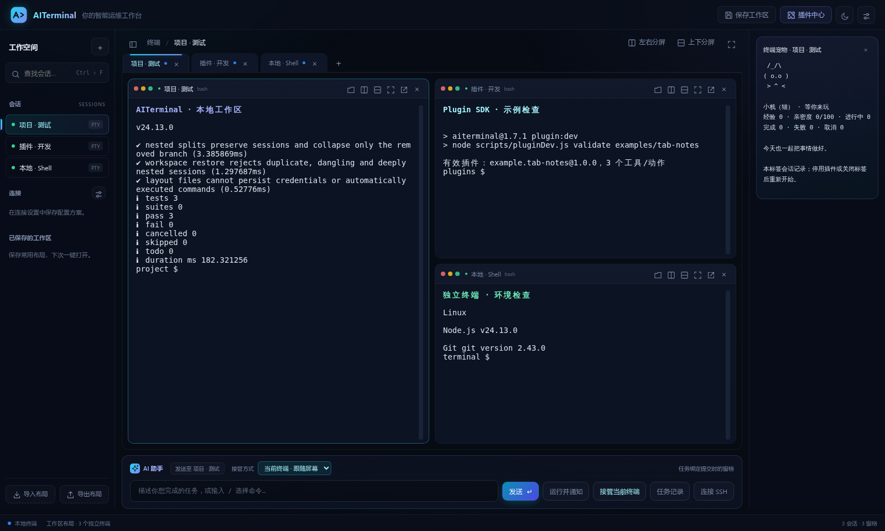
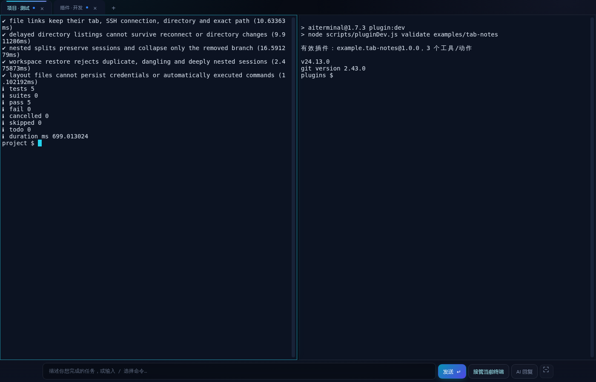
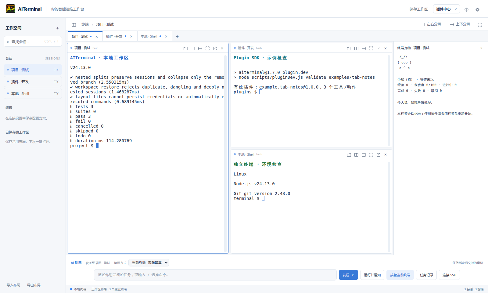
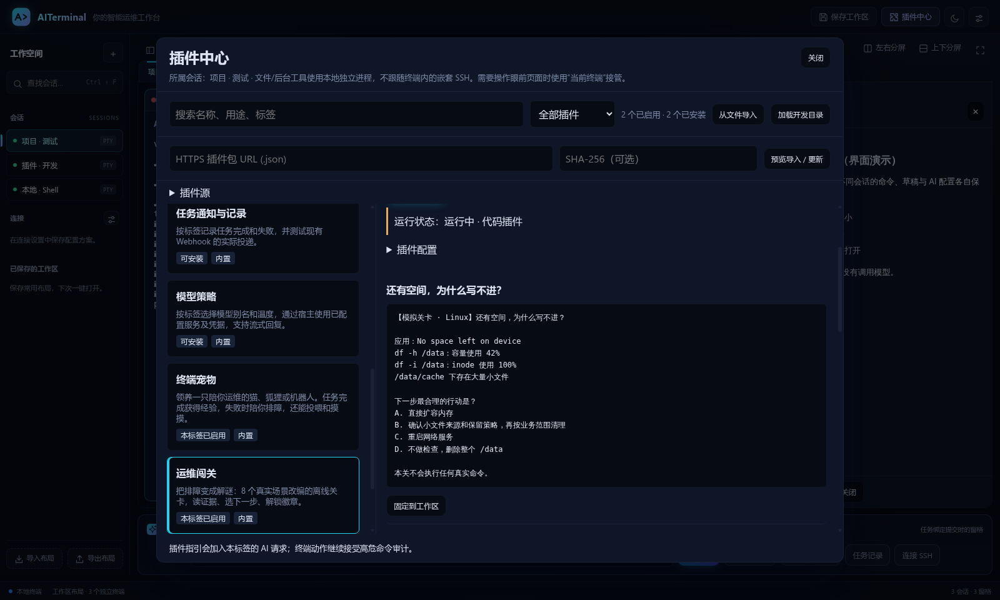

<p align="center"> 渐变 Logo" width="112"></p>

# AITerminal

[English](README_en.md) · [下载](https://github.com/Amo-Zeng/AITerminal/releases/latest) · [安装排障](INSTALLATION.md) · [使用手册](USER_GUIDE.md) · [文档索引](DOCUMENTATION.md) · [插件开发](PLUGIN_SDK.md)

[](LICENSE)
[](https://github.com/Amo-Zeng/AITerminal/actions/workflows/windows-build.yml)

**用 AI 管理本地电脑和远程服务器，也让开发者把自己的运维经验变成插件。**

AITerminal 是基于 Electron、xterm.js 和 SSH2 的开源桌面终端，将本地 PTY、SSH、AI 对话、交互式命令接管和插件中心放在同一工作界面。源码使用 **Apache License 2.0**，支持 Windows、Linux 和 macOS。

## 可以先试这几件事

| 遇到的事情 | 在 AITerminal 中怎么做 |
| --- | --- |
| 已经 SSH 到跳板机，又 SSH 到业务机，想让 AI 接着处理 | 点击该窗格，选择默认的“当前终端”，描述任务；AI 读当前文本屏幕并向同一通道输入，切换分屏不转移任务 |
| Codex / Claude Code 要跑很久，不想守着等 | 用“运行并通知”启动，配置 Webhook 接收结束、异常退出通知；输出关键词匹配可提醒需要介入的情况 |
| 服务器生成了一张图或一份报告 | 用 `rfe 路径` 浏览直连 SSH 主机，点击文件下载并用本机应用打开 |
| 团队有反复执行的巡检或排障流程 | 把流程做成参数化工具、面板或 MCP 集成，放进插件中心；插件按会话启停，面板可固定在工作区 |

程序通知需要应用仍在运行；断线只能报告远端状态未知。文件服务与插件后台工具使用直连主机，不跟随嵌套 SSH。具体边界见 [接管说明](AI_TAKEOVER_MODE_README.md)与[通知文档](WEBHOOKS.md)。

## 功能演示

**工作区与极简模式**：采用青紫渐变与圆角卡片外观，同屏运行独立终端，右侧固定所属会话的插件面板。极简模式（`Ctrl/Cmd+Shift+M`）保留顶部标签栏、终端和底部 AI 输入区，隐藏菜单与侧栏；点击顶部标签切换会话，按需展开 AI 回复，并记住偏好。只有实际获得输入焦点的窗格显示终端光标；点击 AI 输入框、打开弹窗或切出应用时不再闪烁。下图为真实应用截图，终端显示本地测试与插件示例校验结果。



**极简模式**：分屏与连接保持，顶部标签点击切换，下方直接输入 AI 任务。



<details>
<summary>查看浅色界面</summary>



</details>

**插件中心**：下图是实际应用中的运维闯关面板；可直接体验无需模型 Key 的插件，再参考 SDK 制作自己的工具与面板。



保留以下早期版本录屏，展示实际操作方式。当前版本的界面布局、标签隔离和权限确认流程已有升级，以当前应用与文档为准。

**自然语言转命令**：描述“查找所有大于 100 MB 的文件”，查看 AI 给出的命令，再按需执行。


<details>
<summary>展开更多演示：AI 接管、AI 问答、文件拖拽与主题切换</summary>

**AI 接管任务（2 倍速）**：输入“创建一个介绍广义相对论的炫酷网页”，由 AI 执行开发任务，并继续提出修改要求。


**AI 问答与建议**：询问如何查看 Linux 内存使用情况，获取解释和命令示例。


**文件拖拽与传输**：将本地文件拖入已连接的 SSH 终端，上传后浏览和下载远程文件。


**终端主题切换**：调整字体和配色，选择适合自己的终端外观。


</details>

## 能做什么

- **多会话工作区**：本地与不同 SSH 会话左右/上下分屏、拖动调宽与重排、窗格放大、会话搜索；布局可保存、导入和导出，不设商业会话数量配额。
- **本地与远程终端**：直接打开本地 Shell，或连接 SSH；支持 Codex、Vim、tmux 等交互式程序。
- **AI 问答与命令助手**：自然语言问答、`fix` 错误诊断、`analyze` 系统分析、`cmd` 自然语言转命令；支持流式回复、分屏、Markdown、代码高亮、数学公式和自定义回答要求。
- **SSH 文件与命令**：密码/私钥登录、拖拽上传、`rfe` 浏览和下载远程文件；普通 `ls` 输出中匹配直连 SSH 当前目录的文件名可点击直接打开查看，由本机默认应用打开临时副本，无需选择保存位置。`send` 直接发送 Shell 命令，输入 `/` 调出常用命令。
- **配置与外观**：保存/加载配置方案和会话配置、记住认证信息与自动登录、登录后自动命令；可调整主题、字体、光标和滚动历史行数。
- **按标签隔离**：每个标签独立持有连接、AI 配置与历史、接管状态、输出、插件实例和终端尺寸。
- **AI 运维**：对本地、远程或混合目标执行任务；高危命令执行前确认，可信任已核验指纹的指定 SSH 服务器以减少重复弹窗。
- **终端交互**：`Ctrl+Shift+C/V` 复制粘贴；选中文本后 Enter 复制并取消选择；右键复制选中内容或粘贴。tmux/Vim 启用鼠标时接收鼠标和滚轮事件，`Shift+右键` 使用本地剪贴板。tmux 请启用 `set -g mouse on`。
- **任务通知**：HTTPS Webhook 支持任务结果、程序正常/异常停止及屏幕输出关键词匹配；手动交互程序可从“🔔 运行并通知”启动。支持冷却、大小写及可选脱敏片段，详见 [通知说明](WEBHOOKS.md)。
- **插件中心**：参数化工具、模型适配器、标准 MCP、任务事件、面板、配置、插件源和版本恢复；面板可固定到工作区并保持所属会话，提供独立进程、Cordis 生命周期和开发 SDK。
- **凭据与连接保护**：SSH 首次连接确认 SHA-256 主机指纹，密钥变化默认阻断；SSH 凭据、模型 Key 和 Webhook URL 由系统加密存储管理。

AI 默认接管提交任务时选中的终端：读取它的文本屏幕并输入，可继续操作嵌套 SSH 或正在运行的交互程序；任务期间切换焦点不改变执行目标。Windows 本地终端默认 **WSL Ubuntu**，Linux / macOS 使用本机 Shell。高级主机/插件模式使用独立服务，不保证跟随嵌套 SSH，详见 [两种接管方式](AI_TAKEOVER_MODE_README.md)。

### 常用入口

以下内容输入在窗口底部的命令/AI 输入框；终端区域中的输入直接交给 Shell。

| 输入或操作 | 用途 |
| --- | --- |
| `如何查看 Linux 内存使用情况？` | AI 问答；也可用 `ai` / `ask` 前缀 |
| `cmd 查找当前目录中大于 100 MB 的文件` | 生成命令，检查后再按需执行 |
| `fix` / `analyze` | 根据当前窗格的文本屏幕诊断 / 分析；缺少指标时给出采集建议 |
| `send ls -lah` | 将命令发送到本标签的本地或 SSH 终端；无需模型 Key |
| `/` | 搜索已配置的常用命令，选择后按 Enter 发送 |
| `rfe /var/log` | 浏览、下载或下载并打开 SSH 远端文件；终端内 `ls` 的文件名可点击直接打开查看 |
| `search 关键词` | 搜索本标签高级接管的历史索引 |
| “AI 接管” / 右上角“插件中心” / “运行并通知” | 多步任务、插件工具与程序退出通知 |
| “左右分屏” / “上下分屏” / “保存工作区” | 同屏使用多个终端并保存布局；恢复时建立新会话，SSH 需手动重连 |

详细操作、快捷键和更多原版录屏见 [使用手册](USER_GUIDE.md)。

## 安装与开始使用

从 [最新版本下载页](https://github.com/Amo-Zeng/AITerminal/releases/latest) 下载对应平台的 **AITerminal** 安装包，核对该版本附带的 `SHA256SUMS.txt`。**1.7.3** 恢复 `ls` 文件点击直接打开查看，极简模式保留顶部标签栏并移除底部会话下拉框；保留明暗界面、原生分屏、工作区、插件中心、嵌套 SSH 接管和自动同步 Releases 的发布流程。

| 平台 | 安装包 | 运行条件 |
| --- | --- | --- |
| Windows x64 | `.exe` 安装器 | 本地终端需要 WSL 和名为 `Ubuntu` 的发行版；可在管理员终端执行 `wsl --install -d Ubuntu`，完成初始化后启动应用 |
| Linux x64 | `.AppImage` | 下载后添加执行权限；系统需支持 FUSE，或使用 AppImage 的提取运行方式 |
| macOS Apple Silicon | `.dmg` | 当前 CI 产物为 arm64、未签名/未公证；仅在核验来源后按系统提示允许打开 |

当前只提供桌面版本，没有 iOS `.ipa`。安装包不要求用户安装 Node.js。

### macOS 提示“已损坏，无法打开”

当前 macOS 安装包未签名、未公证，可能触发系统隔离提示。先从本项目 Releases 下载并核对 `SHA256SUMS.txt`，把应用拖入“应用程序”；若仍提示“已损坏”或无法验证开发者，在 macOS 自带“终端”执行：

```bash
sudo xattr -r -d com.apple.quarantine /Applications/AITerminal.app
```

然后重新打开应用。这个命令只移除指定应用的下载隔离属性，不能修复真正损坏的文件；校验和不一致时应重新下载。若安装位置不同，请修改路径。完整的 Windows WSL、Linux FUSE 和 macOS 排障步骤见 [安装指南](INSTALLATION.md)。

启动后选择本地终端或配置 SSH；使用 AI 时填写自己的模型 API 地址、模型名与 Key。API 格式支持 **Chat Completions**（`/v1/chat/completions`）、**Responses**（`/v1/responses`）和 **Messages**（`/v1/messages`），可手动选择或根据完整 URL 自动识别，详见 [模型 API 配置](AI_PROVIDERS.md)。插件中心可从右上角“插件中心”或 `Ctrl/Cmd+Shift+P` 打开。终端宠物和运维闯关无需模型 Key，也无需连接服务器。

## 一起建设插件生态

欢迎开发者贡献运维工具、交互式 CLI 助手、模型适配器、MCP 集成、教学插件、文档和测试。AITerminal 提供自己的插件中心与 SDK，内部借鉴 DeepSeek Harness 的组合方式并使用 Cordis 管理生命周期；已有 DSH/Cordis 插件需按服务接口适配，详见 [SDK](PLUGIN_SDK.md)。

| 内置插件 | 可以参考的能力 |
| --- | --- |
| 系统巡检、Docker、Git 审查、交互式 CLI | 声明式指引与静态命令 |
| [Docker 工作台](plugins/docker-tools/index.js) | 参数化工具、只读巡检、交互日志 |
| [任务通知与记录](plugins/task-notifier/index.js)、[模型策略](plugins/model-policy/index.js) | 任务事件、Webhook、模型适配器 |
| [终端宠物](plugins/terminal-pet/index.js)、[运维闯关](plugins/ops-quest/index.js) | 无需 AI 的面板交互、会话状态与事件 |
| [Git 时光机](plugins/git-time-machine/index.js) | 真实 Git 时间线、只读操作、可选 AI 故事 |

从 [贡献指南](CONTRIBUTING.md) 开始，或提交 [插件提案](https://github.com/Amo-Zeng/AITerminal/issues/new?template=plugin_proposal.yml)。[路线图](ROADMAP.md) 列出了插件开发体验、MCP、终端可靠性和跨平台验证等共建方向；不需要先完成一个大型插件才参与。

## 从源码运行

需要 Node.js 22+、npm，以及目标系统的原生模块构建环境（若预编译模块不可用）。不要跨 Windows、Linux、macOS 共用 `node_modules`。

```bash
git clone https://github.com/Amo-Zeng/AITerminal.git
cd AITerminal
npm ci
npm start
```

插件开发最小流程（在项目根目录执行，生成目录位于仓库外）：

```bash
npm run plugin:dev -- new ../hello-aiterminal example.hello
npm run plugin:dev -- validate ../hello-aiterminal
npm run plugin:dev -- pack ../hello-aiterminal ../example.hello.aitplugin.json
```

在插件中心“加载开发目录”后预览安装、在本标签启用，即可运行模板的问候工具。修改文件后需重新导入。完整说明见 [Plugin SDK](PLUGIN_SDK.md)；英文入门见 [Plugin Quickstart](PLUGIN_QUICKSTART.md)。

## 测试与构建

```bash
npm test
npm run security:scan
npm run doctor
# 在目标操作系统选择对应命令：
npm run build:win
npm run build:linux
npm run build:mac:unsigned
```

公开 [GitHub Actions](https://github.com/Amo-Zeng/AITerminal/actions/workflows/windows-build.yml) 在 PR、普通 `push` 到 `main` / `release/**`、`v*` 标签和手动触发时运行三平台构建。Fork 开发者可以在自己的仓库启用 Actions；构建无需维护者私有仓库或模型 Key。每个平台执行锁定安装、测试、依赖审计、真实 Electron/插件/通知检查、打包源码一致性及打包后启动，再上传安装包、校验和与 SBOM。主仓库的非 PR 构建在三平台全部通过后自动同步 Releases；附件上传校验齐全后才更新下载页。Actions 临时产物保留 14 天，正式下载使用 Releases。

按改动范围运行真实交互测试，命令与环境要求见 [贡献指南](CONTRIBUTING.md)。维护者原有私有打包脚本仍保留，使用说明移至 [构建与发布](RELEASING.md)。

## 文档与安全边界

- [文档索引](DOCUMENTATION.md) · [安装与排障](INSTALLATION.md) · [完整使用手册](USER_GUIDE.md) · [English user guide](USER_GUIDE_en.md)
- [AI 接管](AI_TAKEOVER_MODE_README.md) · [插件使用](PLUGINS.md) · [插件 SDK](PLUGIN_SDK.md) · [通知设置](WEBHOOKS.md)
- [贡献指南](CONTRIBUTING.md) · [路线图](ROADMAP.md) · [变更记录](CHANGELOG.md) · [开源检查记录](OPEN_SOURCE_AUDIT.md)
- [安全政策](SECURITY.md) · [行为准则](CODE_OF_CONDUCT.md) · [第三方许可](THIRD_PARTY_NOTICES.md)

AITerminal 以当前本地用户或 SSH 用户的权限运行。工作目录、命令审计和插件独立进程均不等于操作系统权限沙箱；仅启用可信插件。凭据无法安全加密时只在当前会话保留。漏洞请通过 [私密安全报告](https://github.com/Amo-Zeng/AITerminal/security/advisories/new) 提交，避免在公开 Issue 附上密钥或敏感终端输出。

## 联系与反馈

- **问题报告与功能建议**：[GitHub Issues](https://github.com/Amo-Zeng/AITerminal/issues)；交流与插件想法可在 [Discussions](https://github.com/Amo-Zeng/AITerminal/discussions) 发起。
- **Email**：[1019191262@qq.com](mailto:1019191262@qq.com)
- **QQ群**：1053768305

报告问题时请附应用版本、操作系统与架构、本地/WSL/SSH 环境、复现步骤，以及脱敏后的报错或截图；安装失败请说明下载的文件名。安全漏洞按 [安全政策](SECURITY.md) 私下报告。

## 致谢

- 感谢 [linux.do 社区](https://linux.do/)佬友的交流、反馈和支持。
- 感谢 [lorsque](https://github.com/lorsque-sir) 反馈 macOS 安装问题并提供上面的 `xattr` 处理方法。
- 感谢 **Jasonvip** 分享将应用拖入 **Sentinel** 后成功打开的经验。此处保留原 README 中的社区反馈，具体工具版本与行为尚未复核；可优先使用上面的明确命令处理本应用。
- 感谢 [painbaba](https://github.com/painbaba) 贡献英文插件示例，以及所有提交代码、插件、测试和问题反馈的贡献者。

## 许可证

Copyright © Amo Zeng and AITerminal contributors. 本项目采用 [Apache License 2.0](LICENSE)，允许按协议使用、修改和再分发。第三方依赖保留各自许可证。
