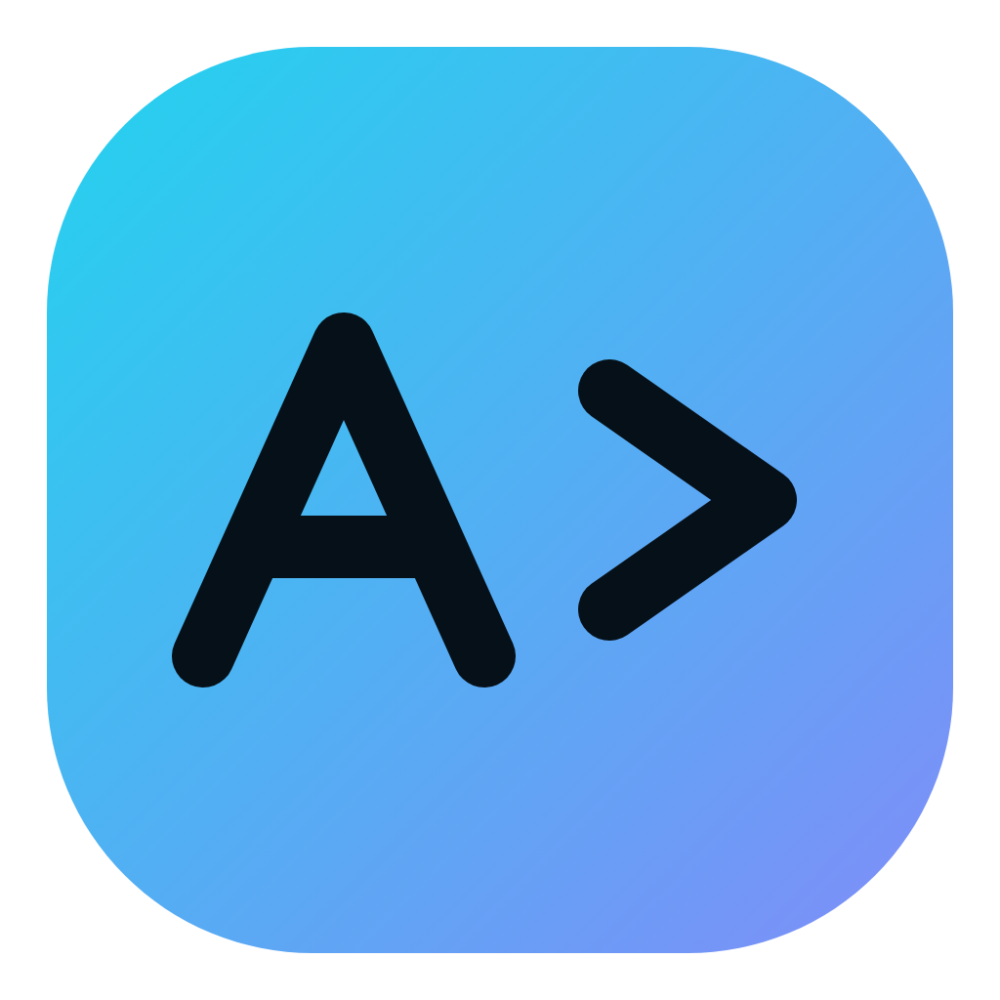
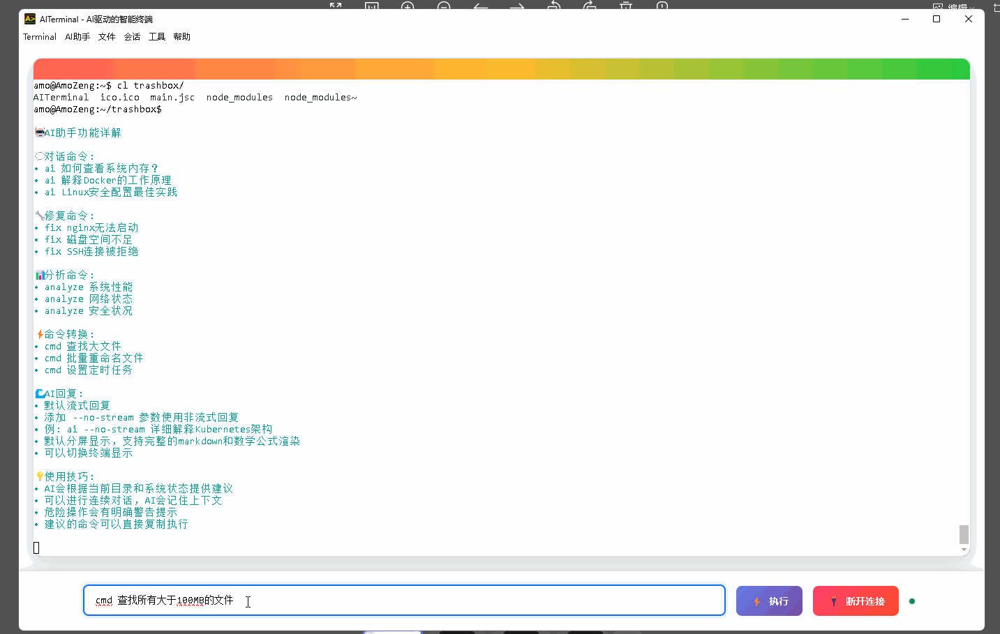
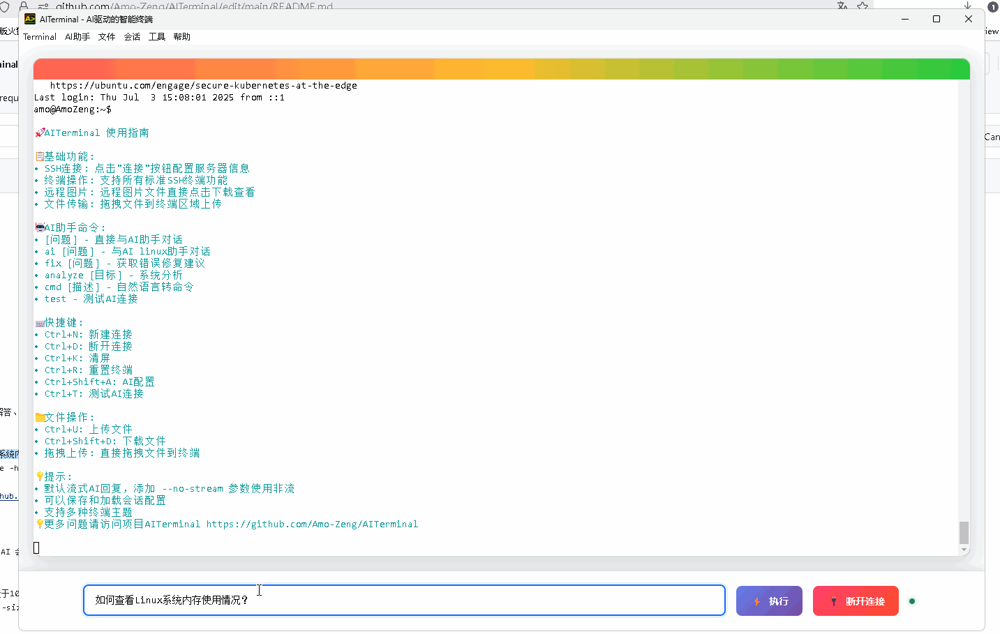
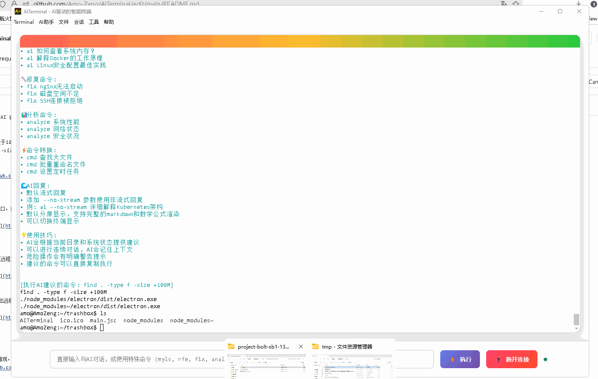
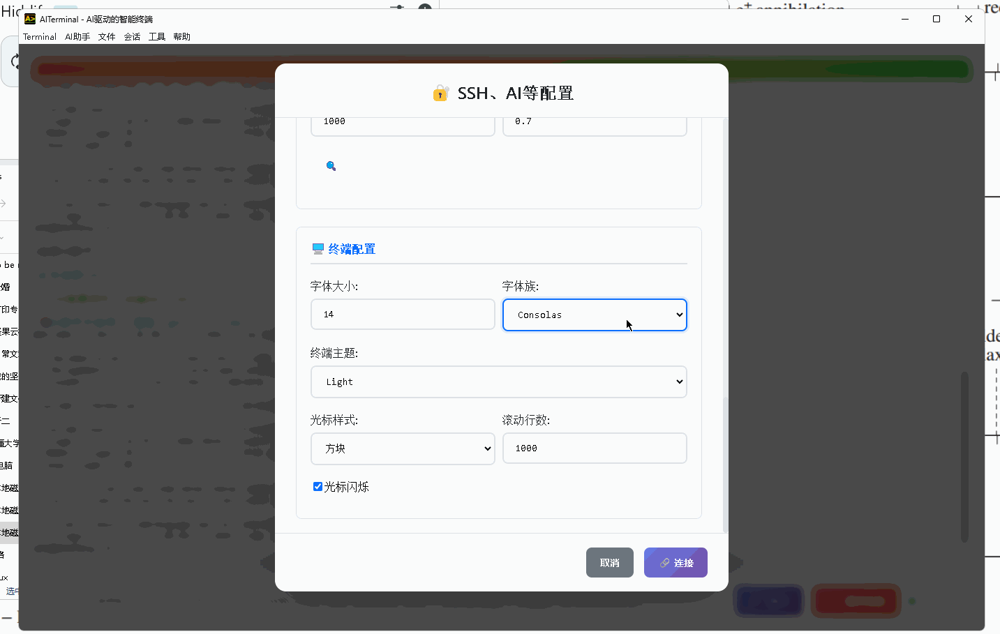

<p align="center"></p>

# AITerminal

[English](README_en.md) · [下载](https://github.com/Amo-Zeng/AITerminal/releases) · [插件开发](PLUGIN_SDK.md) · [参与共建](CONTRIBUTING.md) · [讨论](https://github.com/Amo-Zeng/AITerminal/discussions)

[](LICENSE)
[](https://github.com/Amo-Zeng/AITerminal/actions/workflows/windows-build.yml)

**用 AI 管理本地电脑和远程服务器，也让开发者把自己的运维经验变成插件。**

AITerminal 是基于 Electron、xterm.js 和 SSH2 的开源桌面终端，将本地 PTY、SSH、AI 对话、交互式命令接管和插件中心放在同一工作界面。源码使用 **Apache License 2.0**，支持 Windows、Linux 和 macOS。

## 功能演示

保留以下早期版本录屏，展示实际操作方式。当前版本的界面布局、标签隔离和权限确认流程已有升级，以当前应用与文档为准。

**自然语言转命令**：描述“查找所有大于 100 MB 的文件”，查看 AI 给出的命令，再按需执行。



<details>
<summary>展开更多演示：AI 接管、AI 问答、文件拖拽与主题切换</summary>

**AI 接管任务（2 倍速）**：输入“创建一个介绍广义相对论的炫酷网页”，由 AI 执行开发任务，并继续提出修改要求。


**AI 问答与建议**：询问如何查看 Linux 内存使用情况，获取解释和命令示例。



**文件拖拽与传输**：将本地文件拖入已连接的 SSH 终端，上传后浏览和下载远程文件。



**终端主题切换**：调整字体和配色，选择适合自己的终端外观。



</details>

## 能做什么

- **本地与远程终端**：直接打开本地 Shell，或连接 SSH；支持 Codex、Vim、tmux 等交互式程序。
- **按标签隔离**：每个标签独立持有连接、AI 配置与历史、接管状态、输出、插件实例和终端尺寸。
- **AI 运维**：对本地、远程或混合目标执行任务；高危命令执行前确认，可信任已核验指纹的指定 SSH 服务器以减少重复弹窗。
- **终端交互**：`Ctrl+Shift+C/V` 复制粘贴；选中文本后 Enter 复制并取消选择；右键复制选中内容或粘贴。tmux/Vim 启用鼠标时接收鼠标和滚轮事件，`Shift+右键` 使用本地剪贴板。tmux 请启用 `set -g mouse on`。
- **任务通知**：HTTPS Webhook 支持任务结果、程序正常/异常停止及屏幕输出关键词匹配；手动交互程序可从“🔔 运行并通知”启动。支持冷却、大小写及可选脱敏片段，详见 [通知说明](WEBHOOKS.md)。
- **插件中心**：参数化工具、模型适配器、标准 MCP、任务事件、面板、配置、插件源和版本恢复；提供独立进程、Cordis 生命周期和开发 SDK。
- **凭据与连接保护**：SSH 首次连接确认 SHA-256 主机指纹，密钥变化默认阻断；SSH 凭据、模型 Key 和 Webhook URL 由系统加密存储管理。

AI 跟随当前标签的终端环境：Windows 默认本地终端是 **WSL Ubuntu**，AI 本地接管、交互式程序和插件也在同一 Ubuntu 发行版中运行，使用 Linux 路径。Linux / macOS 使用本地 Shell，SSH 标签使用远程环境。启动本地接管时从可见终端当前目录开始；终端关闭或重建后需重新启动接管。

## 安装与开始使用

从 [最新版本下载页](https://github.com/Amo-Zeng/AITerminal/releases/latest) 下载对应平台的 **AITerminal** 安装包，核对该版本附带的 `SHA256SUMS.txt`。**1.6.0** 包含 Responses / Messages API、AI 与终端环境统一，以及自动同步 Releases 的发布流程。

| 平台 | 安装包 | 运行条件 |
| --- | --- | --- |
| Windows x64 | `.exe` 安装器 | 本地终端需要 WSL 和名为 `Ubuntu` 的发行版；可在管理员终端执行 `wsl --install -d Ubuntu`，完成初始化后启动应用 |
| Linux x64 | `.AppImage` | 下载后添加执行权限；系统需支持 FUSE，或使用 AppImage 的提取运行方式 |
| macOS Apple Silicon | `.dmg` | 当前 CI 产物为 arm64、未签名/未公证；仅在核验来源后按系统提示允许打开 |

当前只提供桌面版本，没有 iOS `.ipa`。安装包不要求用户安装 Node.js。

启动后选择本地终端或配置 SSH；使用 AI 时填写自己的模型 API 地址、模型名与 Key。API 格式支持 **Chat Completions**（`/v1/chat/completions`）、**Responses**（`/v1/responses`）和 **Messages**（`/v1/messages`），可手动选择或根据完整 URL 自动识别，详见 [模型 API 配置](AI_PROVIDERS.md)。插件中心可从底部“🧩 插件”或 `Ctrl/Cmd+Shift+P` 打开。终端宠物和运维闯关无需模型 Key，也无需连接服务器。

## 一起建设插件生态

欢迎在 [linux.do 社区](https://linux.do/)交流使用体验、AI 运维实践和插件创意，也欢迎通过本仓库的 Issues、Discussions 和 Pull Requests 参与共建。

欢迎开发者贡献运维工具、交互式 CLI 助手、模型适配器、MCP 集成、教学插件、文档和测试。AITerminal 提供自己的插件中心与 SDK，内部借鉴 DeepSeek Harness 的组合方式并使用 Cordis 管理生命周期；已有 DSH/Cordis 插件需按服务接口适配，详见 [SDK](PLUGIN_SDK.md)。

| 内置插件 | 可以参考的能力 |
| --- | --- |
| 系统巡检、Docker、Git 审查、交互式 CLI | 声明式指引与静态命令 |
| [Docker 工作台](plugins/docker-tools/index.js) | 参数化工具、只读巡检、交互日志 |
| [任务通知与记录](plugins/task-notifier/index.js)、[模型策略](plugins/model-policy/index.js) | 任务事件、Webhook、模型适配器 |
| [终端宠物](plugins/terminal-pet/index.js)、[运维闯关](plugins/ops-quest/index.js) | 无需 AI 的面板交互、会话状态与事件 |
| [Git 时光机](plugins/git-time-machine/index.js) | 真实 Git 时间线、只读操作、可选 AI 故事 |

从 [贡献指南](CONTRIBUTING.md) 开始，或提交 [插件提案](https://github.com/Amo-Zeng/AITerminal/issues/new?template=plugin_proposal.yml)。[路线图](ROADMAP.md) 列出了插件开发体验、MCP、终端可靠性和跨平台验证等共建方向；不需要先完成一个大型插件才参与。

## 从源码运行

需要 Node.js 22+、npm，以及目标系统的原生模块构建环境（若预编译模块不可用）。不要跨 Windows、Linux、macOS 共用 `node_modules`。

```bash
git clone https://github.com/Amo-Zeng/AITerminal.git
cd AITerminal
npm ci
npm start
```

插件开发最小流程（在项目根目录执行，生成目录位于仓库外）：

```bash
npm run plugin:dev -- new ../hello-aiterminal example.hello
npm run plugin:dev -- validate ../hello-aiterminal
npm run plugin:dev -- pack ../hello-aiterminal ../example.hello.aitplugin.json
```

在插件中心“加载开发目录”后预览安装、在本标签启用，即可运行模板的问候工具。修改文件后需重新导入。完整说明见 [Plugin SDK](PLUGIN_SDK.md)；英文入门见 [Plugin Quickstart](PLUGIN_QUICKSTART.md)。

## 测试与构建

```bash
npm test
npm run security:scan
npm run doctor
# 在目标操作系统选择对应命令：
npm run build:win
npm run build:linux
npm run build:mac:unsigned
```

公开 [GitHub Actions](https://github.com/Amo-Zeng/AITerminal/actions/workflows/windows-build.yml) 在 PR、普通 `push` 到 `main` / `release/**`、`v*` 标签和手动触发时运行三平台构建。Fork 开发者可以在自己的仓库启用 Actions；构建无需维护者私有仓库或模型 Key。每个平台执行锁定安装、测试、依赖审计、真实 Electron/插件/通知检查、打包源码一致性及打包后启动，再上传安装包、校验和与 SBOM。主仓库的非 PR 构建在三平台全部通过后自动同步 Releases；附件上传校验齐全后才更新下载页。Actions 临时产物保留 14 天，正式下载使用 Releases。

按改动范围运行真实交互测试，命令与环境要求见 [贡献指南](CONTRIBUTING.md)。维护者原有私有打包脚本仍保留，使用说明移至 [构建与发布](RELEASING.md)。

## 文档与安全边界

- [AI 接管](AI_TAKEOVER_MODE_README.md) · [插件使用](PLUGINS.md) · [插件 SDK](PLUGIN_SDK.md) · [通知设置](WEBHOOKS.md)
- [贡献指南](CONTRIBUTING.md) · [路线图](ROADMAP.md) · [变更记录](CHANGELOG.md) · [开源检查记录](OPEN_SOURCE_AUDIT.md)
- [安全政策](SECURITY.md) · [行为准则](CODE_OF_CONDUCT.md) · [第三方许可](THIRD_PARTY_NOTICES.md)

AITerminal 以当前本地用户或 SSH 用户的权限运行。工作目录、命令审计和插件独立进程均不等于操作系统权限沙箱；仅启用可信插件。凭据无法安全加密时只在当前会话保留。漏洞请通过 [私密安全报告](https://github.com/Amo-Zeng/AITerminal/security/advisories/new) 提交，避免在公开 Issue 附上密钥或敏感终端输出。

## 许可证

Copyright © Amo Zeng and AITerminal contributors. 本项目采用 [Apache License 2.0](LICENSE)，允许按协议使用、修改和再分发。第三方依赖保留各自许可证。
