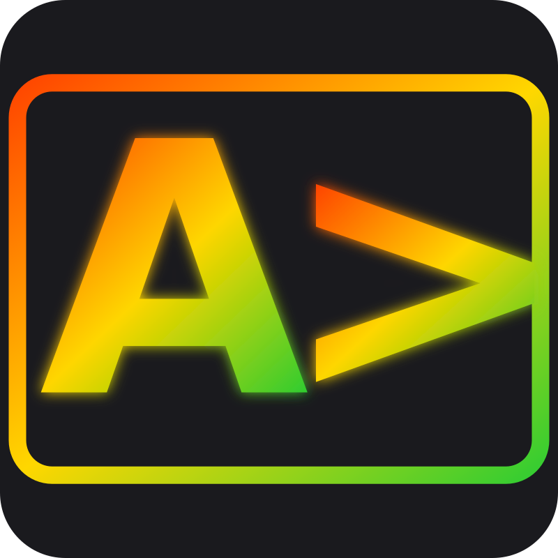

<p align="center"></p>

# AITerminal

[中文](README.md) · [Downloads](https://github.com/Amo-Zeng/AITerminal/releases) · [Plugin quickstart](PLUGIN_QUICKSTART.md) · [Contributing](CONTRIBUTING.md) · [Discussions](https://github.com/Amo-Zeng/AITerminal/discussions)

[](LICENSE)
[](https://github.com/Amo-Zeng/AITerminal/actions/workflows/windows-build.yml)

**Use AI to operate local computers and remote servers, and turn your operations knowledge into plugins.**

AITerminal is an open-source desktop terminal built with Electron, xterm.js and SSH2. It combines local PTYs, SSH, AI conversations, interactive command execution and a Plugin Center. The source is licensed under **Apache License 2.0** and runs on Windows, Linux and macOS.

## Features

- Local and SSH terminals with real PTY support for Codex, Vim, tmux and other interactive tools.
- Independent connections, AI settings/history, execution state, output, plugins and terminal dimensions for every tab.
- AI operations on local, remote or mixed targets; confirmation before recognized high-risk commands, with optional trust for a verified SSH server identity.
- `Ctrl+Shift+C/V` clipboard shortcuts and Enter to copy and clear a selection. Right click copies a selection or pastes; tmux/Vim mouse tracking receives mouse/wheel input, with Shift+right click for the local clipboard. Enable tmux mouse mode with `set -g mouse on`.
- HTTPS Webhooks for task results, program exits and output keyword matches. Use “🔔 Run and notify” for manual interactive commands. Case sensitivity, cooldowns and redacted excerpts are configurable; see [notification details](WEBHOOKS.md).
- A Plugin Center with parameterized tools, model adapters, standard MCP, task events, panels, configuration, catalogs and version recovery. Code plugins use dedicated processes and a Cordis lifecycle.
- SSH host fingerprint verification and platform-encrypted storage for SSH credentials, model API keys and Webhook URLs.

The visible local terminal on Windows defaults to **WSL Ubuntu** (`wsl.exe -d Ubuntu --cd ~`). **Local AI takeover** on Windows uses the host PowerShell environment to operate on Windows working directories. These are separate environments.

## Install

Download an **AITerminal** package from [GitHub Releases](https://github.com/Amo-Zeng/AITerminal/releases) and verify the accompanying SHA-256 checksums. Version 1.5.1 contains this open-source update and Plugin API 1.1; older installers do not contain the latest plugins and program notifications.

| Platform | Package | Requirements |
| --- | --- | --- |
| Windows x64 | `.exe` installer | WSL and a distribution named `Ubuntu` for the local terminal; run `wsl --install -d Ubuntu` in an administrator terminal and finish Ubuntu initialization |
| Linux x64 | `.AppImage` | Make the file executable; use FUSE or AppImage extraction mode |
| macOS Apple Silicon | `.dmg` | Current CI builds are arm64, unsigned and not notarized; verify the source before allowing launch through system settings |

There is no iOS `.ipa` target. Packaged applications do not require Node.js.

Open a local terminal or configure SSH. For AI features, supply your compatible model API endpoint, model name and key. Open the Plugin Center from the bottom toolbar or `Ctrl/Cmd+Shift+P`. Terminal Pet and Ops Quest work without model credentials or a server connection.

## Build the plugin ecosystem with us

Contribute operations tools, interactive CLI helpers, model adapters, MCP integrations, teaching plugins, documentation or tests. AITerminal owns its package format and SDK, drawing inspiration from DeepSeek Harness and using Cordis internally. Existing DSH/Cordis plugins need service-level adaptation; see the [SDK guide](PLUGIN_SDK.md).

| Bundled examples | What to explore |
| --- | --- |
| System health, Docker, Git review, interactive CLI | Declarative instructions and static commands |
| [Docker Workbench](plugins/docker-tools/index.js) | Parameterized tools, inspections and interactive logs |
| [Task Notifier](plugins/task-notifier/index.js), [Model Policy](plugins/model-policy/index.js) | Task events, Webhooks and model adapters |
| [Terminal Pet](plugins/terminal-pet/index.js), [Ops Quest](plugins/ops-quest/index.js) | Offline panels, session state and events |
| [Git Time Machine](plugins/git-time-machine/index.js) | Read-only Git timelines and optional AI stories |

Start with the [contribution guide](CONTRIBUTING.md), try the [plugin quickstart](PLUGIN_QUICKSTART.md), or open a [plugin proposal](https://github.com/Amo-Zeng/AITerminal/issues/new?template=plugin_proposal.yml). The [roadmap](ROADMAP.md) lists concrete collaboration opportunities. Small examples, translations and reproducible bug reports are welcome.

## Run from source

Use Node.js 22+, npm, and native module build tools if prebuilt modules are unavailable. Do not share `node_modules` between operating systems.

```bash
git clone https://github.com/Amo-Zeng/AITerminal.git
cd AITerminal
npm ci
npm start
```

Create a plugin outside the checkout:

```bash
npm run plugin:dev -- new ../hello-aiterminal example.hello
npm run plugin:dev -- validate ../hello-aiterminal
npm run plugin:dev -- pack ../hello-aiterminal ../example.hello.aitplugin.json
```

Load its development directory in the Plugin Center, preview the installation, enable it for one tab and run the greeting tool. Re-import after changing the development files.

## Test and build

```bash
npm test
npm run security:scan
npm run doctor
# Select the command for the target operating system:
npm run build:win
npm run build:linux
npm run build:mac:unsigned
```

The public [Actions workflow](https://github.com/Amo-Zeng/AITerminal/actions/workflows/windows-build.yml) builds all three platforms for pull requests, pushes to `main` / `release/**`, `v*` tags and manual runs. Fork owners can enable Actions in their repositories; no private build repository or model key is required. Checks include locked dependencies, tests, audits, real Electron/plugin/notification smoke tests, source-to-package verification and actual packaged startup. Artifacts include installers, checksums and an SBOM and expire after 14 days; use Releases for durable downloads.

See [Contributing](CONTRIBUTING.md) for focused smoke tests and [Releasing](RELEASING.md) for the optional maintainer build helper.

## Documentation and security

[AI takeover](AI_TAKEOVER_MODE_README.md) · [Plugin usage](PLUGINS.md) · [SDK reference](PLUGIN_SDK.md) · [Notifications](WEBHOOKS.md) · [Roadmap](ROADMAP.md) · [Changelog](CHANGELOG.md) · [Open-source checks](OPEN_SOURCE_AUDIT.md)

AITerminal executes with the current local or SSH user's permissions. A working directory, command audit or separate plugin process is not an operating-system sandbox. Enable trusted plugins only. Credentials remain session-only when secure storage is unavailable. Report vulnerabilities through [private security reporting](https://github.com/Amo-Zeng/AITerminal/security/advisories/new), following the [security policy](SECURITY.md); do not post keys or sensitive terminal output in public issues. Participants follow our [Code of Conduct](CODE_OF_CONDUCT.md).

## License

Copyright © Amo Zeng and AITerminal contributors. Licensed under the [Apache License 2.0](LICENSE). Third-party dependencies retain their own licenses; see [Third-Party Notices](THIRD_PARTY_NOTICES.md).
