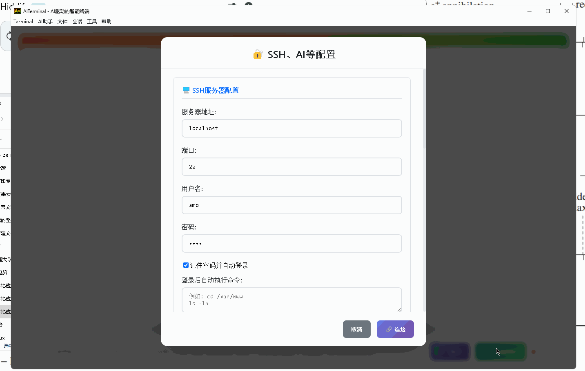
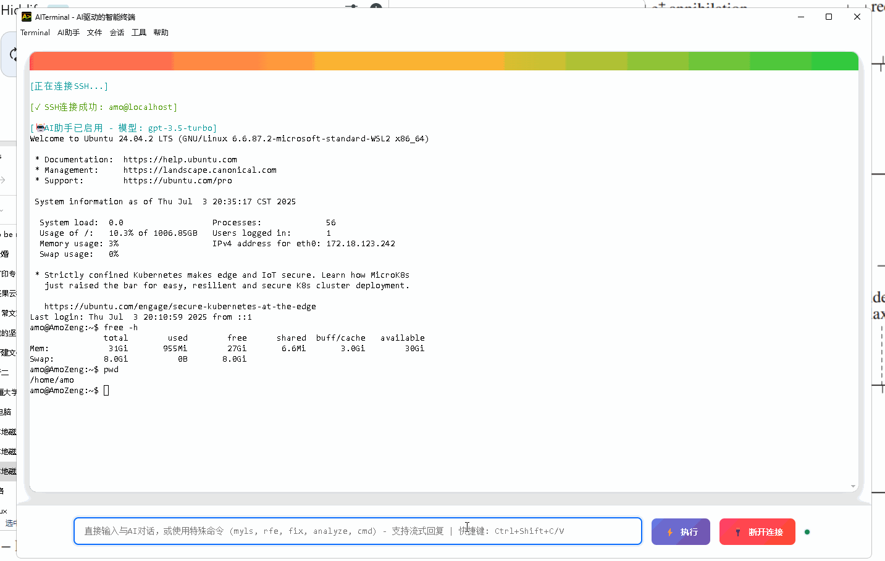

# AITerminal 使用手册

[English](USER_GUIDE_en.md) · [安装与排障](INSTALLATION.md) · [文档索引](DOCUMENTATION.md) · [返回 README](README.md)

## 先区分两个输入位置

- **终端区域**：点击终端后直接输入 Shell 命令，例如 `pwd`、`ls`、`codex`、`tmux`。键盘和鼠标交给当前终端程序。
- **底部命令/AI 输入框**：普通文字用于 AI 对话；`cmd`、`fix`、`analyze`、`send`、`rfe`、`myls`、`search` 是应用入口。这里输入裸 `ls` 会被当作 AI 对话，要直接执行请用 `send ls` 或在终端区域输入。

本地终端和 SSH 不需要模型 Key。AI 问答、命令生成、接管需要先完成 [模型配置](AI_PROVIDERS.md)；终端宠物、运维闯关等插件可以离线使用。

## 本地终端、SSH 与多标签

打开应用即可使用本地终端。Windows 默认 WSL Ubuntu，Linux/macOS 使用本机 Shell。Windows 的 AI 与插件也运行在同一个 Ubuntu 发行版，路径使用 `/home/...`、`/mnt/c/...` 等 Linux 形式。

点击配置管理中的 SSH 页面，填写服务器、端口、用户名，选择密码或私钥认证。私钥可通过“浏览”选择，必要时填写私钥口令。首次连接请核对 SHA-256 主机指纹；指纹变化时会阻断连接。勾选“信任该服务器”可减少已核验服务器上的高危命令确认，不会忽略主机密钥变化。

每个标签独立持有连接、输出、AI 配置和历史、接管任务与插件实例。通过标签栏新建、切换和关闭；关闭标签会清理所属连接与任务。后台标签的响应仍归属原标签。

## 多会话工作区

左侧工作空间列出所有会话。使用工具栏的左右/上下分屏按钮，或窗格标题栏中的图标，将新的本地终端放到当前会话旁边；拖动窗格之间的分隔线调整比例，双击分隔线恢复均分。拖动会话到另一个窗格的左、右、上或下区域可以重新布局；放大按钮只显示当前窗格，关闭放大后恢复布局。每个窗格保留自己的本地 PTY 或 SSH 连接，点击窗格后输入才会送到该目标。

搜索框按会话名或主机名筛选。点击窗格标题可改名，“移到独立标签”可将窗格移出当前分屏组。左侧“连接”列出已保存的 SSH 配置方案，点击后在新会话连接；不会自动发送方案里的登录后命令。

“保存工作区”保存到本机；“导出布局”生成 JSON，“导入布局”打开该文件。它们保存全部会话的布局、名称、连接标识及固定插件面板引用，不保存密码、私钥内容、API Key、Webhook URL、终端进程或命令。文件可能包含主机名、用户名和私钥路径，分享前检查。恢复会追加新会话，不关闭已有会话；本地打开新 Shell，SSH 等待手动重连，不恢复旧进程、目录或任务。断开的 SSH 窗格也会等待重连，不自动切换成本地 Shell。

底部 AI 输入框标注当前目标会话，输入草稿与 AI 配置按会话保留；AI 侧栏跟随焦点，可以拖动边界调宽。**新任务绑定提交时选中的窗格，已经运行的任务保持原窗格，即使你切到另一窗格也不会改目标。** 插件面板的“固定到工作区”同样保持原会话归属。恢复的面板引用不会安装或启用插件，也不会恢复任务；用户设置的“新标签默认启用”仍适用。

当前逐会话执行命令；跨会话批量提交、按键广播与 AI 任务编排仍在规划。没有商业会话数量配额，但实际可用规模取决于系统资源；布局文件校验最多 512 个会话、32 层嵌套、1 MiB。验证范围见 [工作区记录](WORKSPACE_VERIFICATION.md)。



本页录屏为原版 README 中的早期演示；当前按钮布局和确认流程已有更新，按文字说明与实际应用操作。

## AI 问答、诊断与命令生成

| 输入示例 | 行为 |
| --- | --- |
| `如何查看 Linux 内存使用情况？` | 直接提问，支持连续追问；`ai`、`ask` 前缀也可用 |
| `fix` | 根据当前窗格的文本屏幕给出故障诊断和修复建议 |
| `analyze` | 分析当前文本屏幕；不另行在第一层主机采集指标，信息不足时建议进一步检查 |
| `cmd 查找当前目录下大于 100 MB 的文件` | 将自然语言转成命令，查看内容后按需执行 |
| `send printf '%s\n' 'hello world'` | 原样保留命令中的引号和管道，经过命令审计后交给当前标签终端，无需 AI |
| `help` | 查看应用内帮助 |

命令生成和诊断提供的建议需要你判断；多步自动操作使用“AI 接管”。对终端输出、文件路径或模型请求含有敏感数据的情况，应先明确哪些内容适合交给模型服务。

AI 回复默认分屏显示，也可以在“AI 配置 → AI回答显示方式”切换为终端显示。分屏支持流式更新、Markdown、代码高亮、公式渲染和多轮历史。“自定义要求”可填写“请简短回答”等指引；模型、温度和相关选项在同一配置页调整。



## AI 接管与交互式程序

在输入框描述任务后点击“接管当前终端”。例如“检查当前项目的测试失败原因，修复后重新运行测试”。AI 先读取此窗格的文字屏幕，再向原终端输入，每步重新观察。接管日志固定放在 AI 侧栏，避免污染正在运行的全屏程序；可暂停、回答追问、补充要求或重新读屏重试。

默认“当前终端”可以继续操作 SSH 中的另一层 SSH，以及 tmux 的当前 pane、Codex、Vim、Python REPL；输入到达当前前台程序，不会另开第一层主机的命令。它读取文本字符网格，不处理图形桌面或图片；目标主机和前台状态仍需根据屏幕判断。向上滚动的历史与实时活动屏幕分别标记。手动在原终端输入会暂停 AI，输入焦点仍留在终端；底部输入新要求即可继续。暂停不会自动终止前台程序，必要时手动 Ctrl+C。

需要插件工具、独立进程或原有上下文压缩时，选择“高级 · 主机与插件”，或使用 `local:`、`remote:`、`hybrid:` 前缀。高级模式不保证跟随嵌套 SSH，SFTP 与插件文件/执行服务使用直连主机；本地高级模式使用与终端相同的发行版，但目录、变量、交互会话独立。`terminal:` / `终端:` 可显式指定当前终端模式。程序须已安装在实际目标环境中，例如 Windows 的本地 CLI 应安装在 WSL Ubuntu。

`search 关键词` 搜索本标签高级接管的历史索引。当前终端接管自动保留初始任务、最新补充与有限最近历史，每轮最多 40 步后等待继续。历史压缩/索引与插件中心接入外部服务的标准 MCP 是不同功能。

详见 [接管目标、交互接口和权限](AI_TAKEOVER_MODE_README.md)。初始目录不构成权限沙箱，停止任务也不撤销已经执行的系统修改。

## 远程文件传输与浏览

以下入口要求**当前标签已连接 SSH**，操作的是直连 SSH 主机的文件系统，不会自动跟随终端内的第二层 SSH；本地标签直接用 Shell 和系统文件管理器。

- **拖拽上传**：从系统文件管理器将文件拖到终端或底部输入框，上传到当前 SSH 目录。也可使用界面的上传入口选择文件。
- **`rfe [路径]`**：在所属终端下方打开 SFTP 文件面板，终端保持可用。点击目录进入，点击文件下载并用本机应用打开，右侧下载箭头可选择保存位置。省略路径时查询当前远端目录；含空格的路径使用引号，如 `rfe "/home/user/my logs"`。窗格标题的文件按钮从 SSH 默认目录开始浏览。
- **`myls [路径]`**：以终端列表展示文件，点击文件名下载并通过本机默认应用打开，适合查看服务器上的图片和文档。
- **下载入口**：也可直接填写远程文件路径下载。下载并打开意味着文件来到本机，并非远程运行本机应用。

在底部输入框依次试用：

```text
rfe /var/log
myls /home/your-user/Pictures
```

将第二个路径替换为服务器上实际存在的图片或文档目录，再点击文件名下载并打开。

上传会使用所连接账号的文件权限；同名文件可能被覆盖，重要文件先备份。tmux 内部切换目录不一定等同于应用跟踪的 SSH 工作目录，需要时先核对上传目标。

## 常用命令、自动登录与配置方案

在“配置管理 → 常用命令”中每行填写一个 Shell 命令。底部输入 `/` 打开列表，再输入关键词筛选；选择后填入 `send ...`，按 Enter 发送。支持方向键选择和 Esc 关闭列表。

“记住认证信息并自动登录”允许下次启动使用保存的 SSH 配置。密码与私钥口令由系统加密存储，无法使用安全存储时只在本次运行保留。每次连接仍核验主机指纹。需要调整服务器或暂不连接时，可先打开配置核对设置。

“登录后自动执行命令”每行一条，在成功连接后发送到所属 SSH 终端，例如 `cd /var/www`。它是实际执行的命令，不是备注；只填写你希望每次连接都运行的内容。

配置窗口顶部可命名保存、选择加载或删除配置方案。方案保存非敏感配置；切换模型 API 地址后应填写与该服务匹配的 Key。不同标签的 AI 运行配置按各自保存/连接时的设置维护。

“文件 → 保存会话 / 加载会话”导出或导入 JSON **配置文件**。这不保存运行中的进程、SSH 连接、完整屏幕或 AI 对话；导出不含密码、私钥口令、模型 Key 或 Webhook URL。导入后在配置管理中核对并保存/连接，在新机器补齐凭据。会话文件仍可能包含主机名、用户名和本地路径，分享前检查。

上述单份配置文件与右上角的“保存工作区”用途不同；需要恢复多个窗格时使用工作区布局。

## 外观与快捷键

“配置管理 → 终端配置”可调整字体、字号、主题、光标样式（方块/下划线/竖线）、闪烁和滚动历史行数。窗口或分屏大小变化会调整可见终端，切回后台标签后同步其尺寸。

| 操作 | 效果 |
| --- | --- |
| `Ctrl+Shift+C` / `Ctrl+Shift+V` | 复制选中终端文本 / 粘贴；也支持 `Cmd+Shift+C/V` |
| 终端有选中文本时按 Enter | 复制并取消选中，不发送回车给 Shell |
| 右键 | 有选中内容则复制，否则粘贴 |
| `Shift+右键` | 强制使用本地剪贴板操作 |
| `Ctrl/Cmd+Shift+P` | 打开插件中心 |
| `Ctrl/Cmd+Shift+E` | 在当前窗格旁左右分屏 |
| `Ctrl/Cmd+Alt+Shift+E` | 在当前窗格旁上下分屏 |
| `Ctrl/Cmd+Shift+←/→` | 切换当前分屏组的窗格 |
| `Ctrl/Cmd+Shift+F` | 搜索会话 |
| 分隔线获得焦点后按方向键 / Home | 调整比例 / 恢复均分；也可拖动或双击 |
| tmux 中 `set -g mouse on` | 启用 tmux 鼠标；此时常规鼠标和滚轮事件交给 tmux |

tmux/Vim 开启鼠标跟踪时，右键和滚轮的行为由该程序决定；这与普通终端历史滚动不同。

## 插件与通知

插件中心支持安装预览、按标签启用、插件参数配置、自定义 HTTPS 源和历史版本恢复。开发者可扩展工具、指引、面板、事件、模型和 MCP；自带 Docker 工作台、Git 时光机、终端宠物、运维闯关等 10 个示例。操作见 [插件使用](PLUGINS.md)，开发见 [SDK](PLUGIN_SDK.md)。

Webhook 可通知 AI 任务结果、程序正常/异常停止和屏幕输出关键词匹配。在设置中填写 HTTPS URL、选择事件并测试。手动执行的程序需要退出通知时，从底部“🔔 运行并通知”启动；输出匹配可设置关键词、大小写和冷却。具体覆盖范围见 [WEBHOOKS.md](WEBHOOKS.md)，进程突然被强杀或系统断电时应用本身无法继续发出网络通知。

## 获取帮助

[安装排障](INSTALLATION.md) · [GitHub Issues](https://github.com/Amo-Zeng/AITerminal/issues) · [邮箱 1019191262@qq.com](mailto:1019191262@qq.com) · QQ 群 **1053768305**。报告时提供版本、系统、目标环境和复现步骤，附脱敏后的错误信息。
