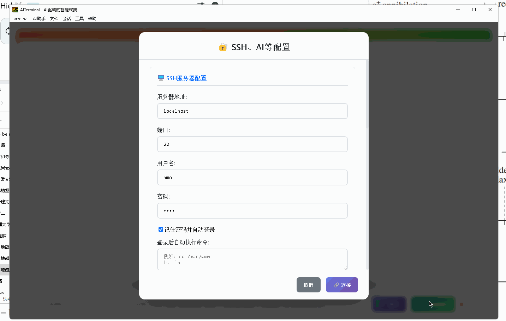
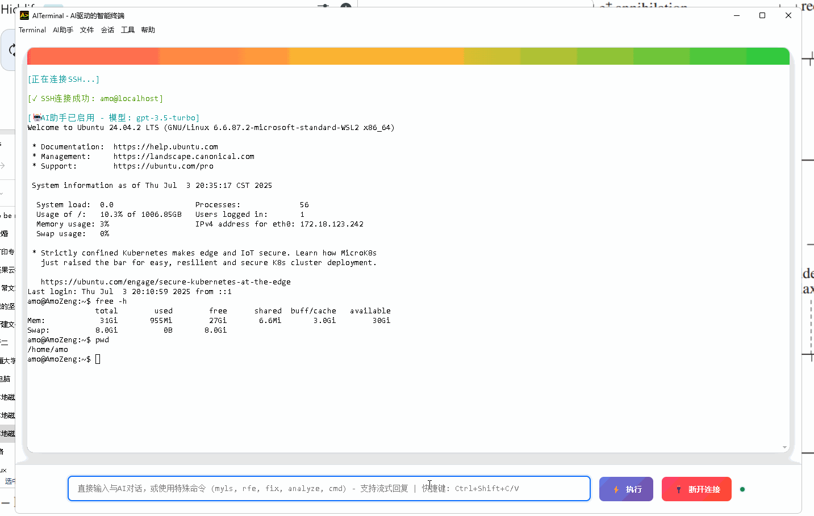

# AITerminal user guide

[中文](USER_GUIDE.md) · [Installation](INSTALLATION.md#english) · [Documentation index](DOCUMENTATION.md) · [README](README_en.md)

## Two input areas

Type shell commands such as `pwd`, `ls`, `codex` or `tmux` directly in the **terminal**. Keyboard and mouse input goes to its running program.

The **bottom command/AI input** accepts questions and application commands: `cmd`, `fix`, `analyze`, `send`, `rfe`, `myls` and `search`. Bare `ls` here is treated as an AI question; use `send ls` to send it to the shell. Local terminals and SSH need no model key. AI features require [provider configuration](AI_PROVIDERS.md); offline plugins such as Terminal Pet and Ops Quest do not.

## Local terminals, SSH and tabs

The app opens a local terminal. Windows uses WSL Ubuntu; Linux/macOS use a local shell. AI and plugins follow the same environment, including `/home/...` and `/mnt/c/...` paths on Windows.

Open SSH settings, enter host, port and username, and choose password or private-key authentication. Browse for a key and supply its passphrase if needed. Verify the SHA-256 host fingerprint on first connection. A changed host key blocks connection. Trusting a verified server reduces command confirmation prompts but never bypasses host-key changes.

Each tab owns its connection, output, AI configuration/history, takeover tasks and plugin instances. Closing a tab cleans up those resources; background responses remain with their originating tab.

## Multi-session workspaces

Use the horizontal/vertical split buttons to open an independent local terminal beside the current pane. Drag dividers to resize; double-click to restore equal sizes. Drag a session from the sidebar or tab strip onto an edge of another pane to rearrange it. Zoom shows one pane temporarily; detach moves it to a separate tab. Moving panes retains their xterm and PTY/SSH connection. Click a pane to direct keyboard input to it.

Search sessions by name or hostname; click a pane title to rename it. Saved SSH profiles appear under Connections and open in new sessions, without sending their startup commands automatically.

Save workspace stores the layout locally; Export layout writes JSON and Import layout opens it. Layouts contain session names, connection identities and pinned-panel references, without passwords, key contents, API keys, Webhook URLs, processes or commands. Hostnames, usernames and private-key paths can still appear; inspect before sharing. Restore appends new sessions and preserves existing ones. Local panes start new shells; SSH panes require manual reconnection. Old processes, working directories and tasks are not restored. Disconnected SSH panes also wait for reconnection instead of falling back to a local shell.

The bottom input labels its target and retains each session's draft and AI settings. The AI sidebar follows focus and can be resized. Pin a plugin panel to keep it visible with its original session ownership. Restoring a panel reference does not install/enable plugins or resume tasks; the user's existing defaults for new tabs still apply.

Commands currently run per session; batch execution, keystroke broadcasting and AI orchestration across sessions remain planned. There is no commercial session quota, but usable scale depends on resources. Imported layouts are validated with limits of 512 sessions, 32 nesting levels and 1 MiB. See [workspace verification](WORKSPACE_VERIFICATION.md) for measured coverage.



These recordings are preserved from the original README. UI layout and confirmation behavior have since changed; follow the current app and instructions.

## AI chat, diagnostics and command generation

| Input | Behavior |
| --- | --- |
| `How do I check Linux memory usage?` | Chat and follow-up questions; `ai` and `ask` prefixes also work |
| `fix` | Diagnose recent output and context from this tab |
| `analyze` | Collect system information for analysis by the configured model |
| `cmd find files over 100 MB in the current directory` | Generate a shell command for review before execution |
| `send printf '%s\n' 'hello world'` | Send the shell payload with quotes/pipes intact through command auditing, without AI |
| `help` | Show in-app help |

Review generated commands and recommendations. Use AI takeover for multi-step execution. Understand which terminal output and system information you send to your configured model service.

AI replies default to a split view; AI settings also offer terminal output. The split view supports streaming, Markdown, syntax highlighting, math and conversation history. Custom answer requirements, such as “keep replies concise,” are configurable alongside the model and temperature.



## AI takeover and interactive tools

Describe a task, then click AI takeover. For example, ask it to diagnose failed tests, fix the cause and rerun them. You can stop execution, answer questions, add instructions, retry failed requests or compress takeover context. Continue with further changes after a task finishes.

Use `local:`, `remote:` or `hybrid:` to select targets. The default is the connected SSH host, otherwise local. Local takeover starts from the visible terminal's current directory and then tracks its own working directory. Supply an absolute path when working in a different tmux pane directory.

Codex, Vim and REPLs can run manually in the terminal or through takeover's independent PTY sessions. The programs must be installed in the target environment, including WSL Ubuntu for the Windows local terminal. `search keyword` searches this tab's takeover history index; this context index is distinct from standard MCP integrations in the Plugin Center.

See [AI takeover](AI_TAKEOVER_MODE_README.md) for targets, interaction and permissions. The working directory is not a sandbox, and cancelling a task does not undo executed changes.

## Remote file transfer and browsing

These features require SSH in the current tab. Use the local shell and file manager on local tabs.

- **Upload:** drag local files from your system file manager into the terminal or bottom input. Files go to the current SSH directory. The upload button also opens a file picker.
- **`rfe [path]`:** open an SFTP file pane below its terminal, which remains usable. Click directories to navigate, files to download and open locally, or the download arrow to choose a save location. Omitting the path queries the current remote directory. Quote paths with spaces, such as `rfe "/home/user/my logs"`. The pane's file button starts from the SSH default directory.
- **`myls [path]`:** show a terminal file listing with clickable filenames. Clicking downloads the file and opens it in the local default application, useful for remote images or documents.
- **Download:** the download control also accepts a remote file path. Download-and-open brings a file to your computer; it does not launch a local viewer on the remote host.

Try these in the bottom input:

```text
rfe /var/log
myls /home/your-user/Pictures
```

Replace the second path with an existing image/document directory on your server, then click a filename to download and open it.

Uploads use the SSH user's permissions and may overwrite same-named files. Check the destination, especially when a tmux pane's directory differs from the SSH directory tracked by the app.

## Saved commands, automatic login and profiles

Enter one shell command per line in common-command settings. Type `/` in the bottom input, filter by text, select a command and press Enter to send the resulting `send ...` payload. Arrow keys select entries and Escape dismisses the list.

Remembered authentication enables automatic SSH login on launch. Passwords and passphrases use platform encryption and remain session-only when secure storage is unavailable. Host fingerprints are still checked. Post-login commands run one line at a time after successful connection; enter only commands you intend to run every time, such as `cd /var/www`.

The configuration dialog can save, load and delete named profiles. Profiles contain non-secret settings. Supply the matching key when changing model endpoints. AI runtime settings remain scoped to the tab where they were configured.

File → Save session / Load session exports/imports a JSON **configuration**, not running processes, SSH connections, screen contents or AI conversation history. Passwords, key passphrases, model keys and Webhook URLs are excluded. Review imported settings in the configuration dialog before saving/connecting; configure credentials again on a new computer. Exported files may still contain hostnames, usernames and paths.

This single-configuration export differs from Save workspace in the top-right toolbar; use workspace layouts to reopen multiple panes.

## Appearance and shortcuts

Terminal settings include font, size, theme, cursor shape (block/underline/bar), cursor blink and scrollback lines. Resizing adjusts the visible terminal and updates background tabs when they become visible.

| Action | Result |
| --- | --- |
| `Ctrl+Shift+C/V` | Copy selected terminal text / paste; `Cmd+Shift+C/V` also works |
| Enter with terminal text selected | Copy and clear selection without sending Enter to the shell |
| Right click | Copy a selection, otherwise paste |
| Shift+right click | Use the local clipboard even when an application tracks mouse input |
| `Ctrl/Cmd+Shift+P` | Open the Plugin Center |
| `Ctrl/Cmd+Shift+E` | Split left/right beside the current pane |
| `Ctrl/Cmd+Alt+Shift+E` | Split top/bottom beside the current pane |
| `Ctrl/Cmd+Shift+Left/Right` | Focus the previous/next pane in the split group |
| `Ctrl/Cmd+Shift+F` | Search sessions |
| Arrow keys / Home on a focused divider | Adjust the ratio / restore equal sizes; dragging and double-clicking also work |
| `set -g mouse on` in tmux | Enable tmux mouse handling |

When tmux/Vim tracks the mouse, that application receives ordinary mouse and wheel events; its behavior differs from scrolling terminal history.

## Plugins and notifications

The Plugin Center supports installation previews, per-tab enablement/configuration, custom HTTPS catalogs and version recovery. Extend tools, prompts, panels, events, models and MCP. The 10 bundled examples include Docker Workbench, Git Time Machine, Terminal Pet and Ops Quest. See [plugin usage](PLUGINS.md), the [English quickstart](PLUGIN_QUICKSTART.md) and [SDK](PLUGIN_SDK.md).

Configure a Webhook HTTPS URL, enable the desired events and test delivery. Notifications cover AI task results, normal/abnormal program exits and matching terminal output. Use “Run and notify” for manual commands that need exit notifications. Keyword matching supports case sensitivity and cooldowns. See [Webhooks](WEBHOOKS.md) for exact coverage; an app that is forcibly killed or a computer that loses power cannot itself send a later network notification.

## Support

[Installation troubleshooting](INSTALLATION.md#english) · [GitHub Issues](https://github.com/Amo-Zeng/AITerminal/issues) · [1019191262@qq.com](mailto:1019191262@qq.com) · QQ group **1053768305**. Include app/OS versions, the target environment and reproduction steps, with redacted errors.
